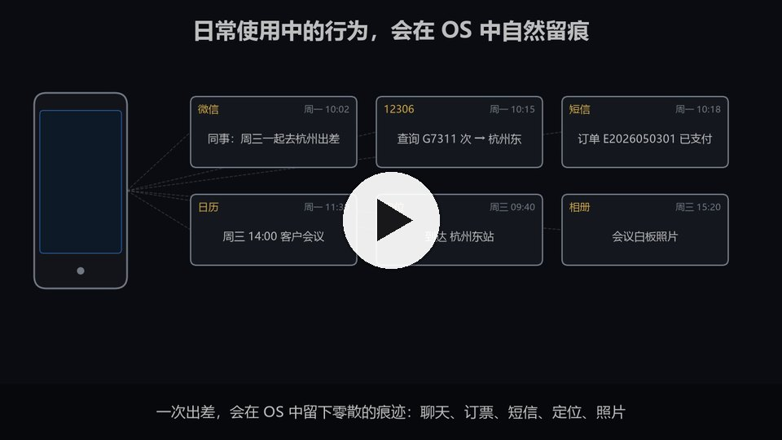

# OS-Memory

**OS-Centric Personal Memory**

[English](README.md) · [中文](README.zh.md)

[](docs/assets/hypermemory-demo.mp4)

This guide is for developers who feed personal device data into OS-Memory and use the resulting memory in their own applications or agents. It covers what the system does, how to install it, how to feed each kind of data, every interface, and how to evaluate on PMM-Bench.

## Contents

- [Chapter 1 Introduction](#chapter-1-introduction)
- [Chapter 2 Installation](#chapter-2-installation)
- [Chapter 3 Quick start](#chapter-3-quick-start)
- [Chapter 4 Feeding data](#chapter-4-feeding-data)
- [Chapter 5 API reference](#chapter-5-api-reference)
- [Chapter 6 Evaluating on PMM-Bench](#chapter-6-evaluating-on-pmm-bench)
- [Chapter 7 Troubleshooting](#chapter-7-troubleshooting)
- [License](#license)

---

## Chapter 1 Introduction

### 1.1 What OS-Memory is

> OS-Memory's Python package is `hyperos-mem`, imported as `hypermem`; the main class is `HyperMemory`.

OS-Memory is a personal memory system for operating systems. It takes the fragments a device records — screen content, SMS, notifications, calendar entries, locations, recordings, conversations with an assistant — and turns them into a **searchable personal memory graph** that answers questions about the user, such as "which train tickets did I book recently" or "what do I have scheduled on Wednesday".

The implementation in this repository is **OS-Memory**, published as a Python library:

| Item | Value |
| --- | --- |
| pip package | `hyperos-mem` |
| Import name | `hypermem` |
| Core interface | the `HyperMemory` class: `add` / `build` / `search` / `read` |
| Storage | one SQLite file per user |
| Usage | Python library, or an MCP server for clients such as Claude Desktop, Cursor and Claude Code |

### 1.2 Typical uses

- **Long-term memory for a personal assistant**: retrieve the user's memory before answering and put the relevant events and facts into the context.
- **Linking events across apps**: group the 12306 ticket query, the payment SMS and the travel reminder into one trip.
- **Building a user profile**: induce long-term preferences and habits from repeated events, such as ordering Sichuan food delivery at weekends.
- **Browsing and auditing memory**: browse by time, entity or order number and trace every item back to the raw records the user submitted.

### 1.3 How it works

OS-Memory arranges memory in five layers, each digesting the one below:

```text
long-term memory (long_memory)   conclusions drawn across several events, e.g. "the user is planning a trip to Hangzhou"
  └─ event                        one complete happening, e.g. "search ticket + pay + travel"
       ├─ fact                    a one-sentence conclusion extracted from an event, with the observations that support it
       └─ observation             one parsed record: text, identifiers, time, source app
            └─ raw record         the JSON line submitted through add, stored as is
```

Construction runs on two paths:

| Path | Name | What it does | Model calls |
| --- | --- | --- | --- |
| Fast path | DRED | Attributes each observation to an event in time order: match on event identifiers such as order numbers first, then on entities, then on semantic similarity | Embedding model only, no LLM |
| Slow path | SAGE | ① Boundary consolidation: review event merges and splits; ② write a title and summary and extract facts for every event; ③ induce long-term memories across events | LLM and embedding model |

Once the graph is built, `search` performs semantic retrieval over it and `read` browses it structurally.

### 1.4 Limits

- **Text only.** The system never opens images, audio or video files. Multimodal content must be turned into text upstream (VLM description, OCR, speech transcription); see [section 4.17](#417-preprocessing-multimodal-data).
- **One database per user.** `add` does not check `user`; if records for different users land in one database, `build` fails with `Mixed users in one memory`. The records are already stored by then, so the only fix is a new database.
- **Batch construction.** Write all records, then build once. Once a build starts you cannot add records; to record another batch of data, start a new database.
- **Construction needs model services.** Building requires an OpenAI-compatible LLM and an embedding service; retrieval needs only the embedding service.
- **Windows is not supported directly.** The database write lock relies on POSIX `fcntl`, so file-backed databases cannot be opened on Windows. Use WSL.

### 1.5 Data and privacy

OS-Memory handles highly personal data: SMS, locations, notifications, chats. Know where the data goes before you use it:

| Operation | Network | What is sent |
| --- | --- | --- |
| `add`, `read`, `count` | No | — |
| `build` | Yes | Observation text goes to the embedding service; events and their observation text go to the LLM to write titles, summaries, facts and long-term memories |
| `search` | Yes | The query text goes to the embedding service |

- **Model services.** Data is sent to the LLM and embedding service you configure in `config` or in environment variables. Before using a third-party service, check its data retention, training use and data-residency terms: a local database does not mean all processing is local. For fully local processing, deploy the model services yourself.
- **Local storage.** Raw records, observations, events, facts, long-term memories and vectors are stored in plain text in the SQLite database. New database files are created with mode `0600` (readable and writable by the current user only). Keep the database in a protected directory and use disk encryption where appropriate.
- **Deletion.** Delete the database file and the `-wal`, `-shm` and `.writer.lock` files beside it to delete all memory for that user.
- **Request log.** Setting `HYPERMEM_REQUEST_LOG=<path>` appends the full content and reply of every model request to that file in plain text. It is off by default and meant for debugging and evaluation only; `pmm_bench` turns it on inside its output directory.
- **MCP server.** The MCP server runs with the permissions of the user who started it, and `add`'s `jsonl_path` can read any file that user can access. Only connect MCP clients you trust.
- **Security issues** — please report them privately, as described in [SECURITY.md](SECURITY.md).

---

## Chapter 2 Installation

### 2.1 Requirements

| Item | Requirement |
| --- | --- |
| Operating system | Linux or macOS; on Windows use WSL |
| Python | 3.10 or newer |
| Other | git |
| LLM service | An OpenAI-compatible Chat Completions endpoint (URL ending in `/v1`) that supports **function calling** (`tools`) and **JSON Schema structured output** (`response_format`) |
| Embedding service | An OpenAI-compatible Embeddings endpoint (URL ending in `/v1/embeddings`), with a model name and vector dimension |

> Construction and retrieval must use **the same embedding service, model and dimension**; otherwise retrieval results are meaningless.

### 2.2 Option 1: install the Python library

For calling OS-Memory from your own Python code or agent.

**One command** (no clone needed; installs the library and the MCP server):

```bash
pip install "hyperos-mem[mcp] @ git+https://github.com/XiaoMi/os-memory.git"
```

Append `@<tag>` (for example `@v1.0.0`) to pin a version. git must be installed; run it inside a virtual environment.

**Or clone and install**:

```bash
git clone https://github.com/XiaoMi/os-memory.git
cd os-memory
python -m venv .venv
source .venv/bin/activate
pip install -e .
```

Verify:

```bash
python -c "from hypermem import HyperMemory; print('hypermem ok')"
```

`hypermem ok` means the install succeeded.

### 2.3 Option 2: install the MCP server

For using OS-Memory directly from an MCP client such as Claude Desktop, Cursor or Claude Code. The server exposes tools named after the library methods:

| Tool | Library method | Purpose |
| --- | --- | --- |
| `add(records, jsonl_path, user)` | `add` | Write records. Pass either `records` (an array of records) or `jsonl_path` (a JSONL file path, which must be **absolute** on the machine running the server) |
| `build()` | `build` | Build the memory graph. Runs in the background and returns immediately; follow progress with `status` |
| `search(query, top_k, as_text)` | `search` | Semantic retrieval |
| `read(...)` | `read` | Structured browsing |
| `status()` | `is_started` / `is_built` / `count()` | Database and build state |

**Step 1: install** (adds the `[mcp]` extra to 2.2; the one-command install in 2.2 already includes it, so you can skip the install and just verify)

```bash
pip install -e ".[mcp]"
python -c "from hypermem.mcp_server import build_server; build_server(); print('mcp ok')"
```

`mcp ok` means the install succeeded.

**Step 2: register the server with your client**

Claude Desktop and Cursor use the same configuration:

```json
{
  "mcpServers": {
    "hypermemory": {
      "command": "/absolute/path/to/os-memory/.venv/bin/python",
      "args": ["-m", "hypermem.mcp_server"],
      "env": {
        "HYPERMEM_DB": "/absolute/path/to/memory.db",
        "HYPERMEM_EMBEDDING_URL": "https://your-gateway/v1/embeddings",
        "HYPERMEM_EMBEDDING_MODEL": "<embedding model>",
        "HYPERMEM_EMBEDDING_DIMENSION": "<vector dimension>",
        "HYPERMEM_EMBEDDING_API_KEY": "<key, if the service needs one>",
        "HYPERMEM_LLM_BASE_URL": "https://your-gateway/v1",
        "HYPERMEM_LLM_MODEL": "<LLM model>",
        "HYPERMEM_LLM_API_KEY": "<key, if the service needs one>"
      }
    }
  }
}
```

| Client | Configuration file |
| --- | --- |
| Claude Desktop (macOS) | `~/Library/Application Support/Claude/claude_desktop_config.json` |
| Claude Desktop (Windows) | `%APPDATA%\Claude\claude_desktop_config.json` |
| Cursor | `~/.cursor/mcp.json` (global) or `.cursor/mcp.json` in the project |

Claude Code registers the server with a command:

```bash
claude mcp add hypermemory \
  -e HYPERMEM_DB=/absolute/path/to/memory.db \
  -e HYPERMEM_EMBEDDING_URL=https://your-gateway/v1/embeddings \
  -e HYPERMEM_EMBEDDING_MODEL=<embedding model> \
  -e HYPERMEM_EMBEDDING_DIMENSION=<vector dimension> \
  -e HYPERMEM_LLM_BASE_URL=https://your-gateway/v1 \
  -e HYPERMEM_LLM_MODEL=<LLM model> \
  -- /absolute/path/to/os-memory/.venv/bin/python -m hypermem.mcp_server
```

Restart the client afterwards. When `add`, `build`, `search`, `read` and `status` appear in the tool list, the server is connected.

**Environment variables**

| Variable | Needed for | Meaning |
| --- | --- | --- |
| `HYPERMEM_DB` | Always | Absolute path of the database file. Created by the first `add` if missing (its directory must exist) |
| `HYPERMEM_EMBEDDING_URL` / `_MODEL` / `_DIMENSION` | `search`, `build` | Embedding endpoint, model and dimension |
| `HYPERMEM_EMBEDDING_API_KEY` | If the service needs one | Embedding service key |
| `HYPERMEM_LLM_BASE_URL` / `_MODEL` | `build` | LLM endpoint and model; can be omitted when only querying |
| `HYPERMEM_LLM_API_KEY` | If the service needs one | LLM service key |

Notes:

- `command`, `HYPERMEM_DB` and `add`'s `jsonl_path` must all be **absolute paths**. The client starts the server as a subprocess that inherits neither the current directory nor an activated virtual environment.

**Optional tuning variables** (defaults apply when unset)

| Variable | Default | Meaning |
| --- | --- | --- |
| `HYPERMEM_LLM_PATH` | `/chat/completions` | LLM endpoint path, appended to `HYPERMEM_LLM_BASE_URL` |
| `HYPERMEM_LLM_MAX_TOKENS` | `8192` | Maximum tokens per reply |
| `HYPERMEM_LLM_TIMEOUT` | `180` | Timeout of one LLM request, in seconds |
| `HYPERMEM_LLM_RETRIES` | `2` | Retries after a failed LLM request |
| `HYPERMEM_EMBEDDING_BATCH_SIZE` | `32` | Texts per embedding request |
| `HYPERMEM_EMBEDDING_PROTOCOL` | `openai` | Embedding protocol, `openai` or `tei` |
| `HYPERMEM_EMBEDDING_TIMEOUT` | `60` | Timeout of one embedding request, in seconds |
| `HYPERMEM_EMBEDDING_RETRIES` | `2` | Retries after a failed embedding request |

### 2.4 Configuring model services (library)

With the Python library, model services are passed through the `config` constructor argument. Keys live in environment variables; the configuration only names them:

```python
config = {
    "llm": {
        "base_url": "https://your-gateway/v1",        # ends in /v1
        "model": "<LLM model>",
        "api_key_env": "OPENAI_API_KEY",              # name of the variable holding the key
    },
    "embedding": {
        "url": "https://your-gateway/v1/embeddings",  # ends in /v1/embeddings
        "model": "<embedding model>",
        "dimension": 1024,
        "api_key_env": "OPENAI_API_KEY",
    },
}
```

| Section | Required keys | Optional keys (default) |
| --- | --- | --- |
| `llm` | `base_url`, `model` | `api_key_env`, `path` (`/chat/completions`), `max_tokens` (8192), `timeout` (180 s), `retries` (2) |
| `embedding` | `url`, `model`, `dimension` | `api_key_env`, `protocol` (`openai`, or `tei`), `batch_size` (32), `timeout` (60 s), `retries` (2) |

`embedding.url` may also be written as `base_url` plus `path` (`path` defaults to `/v1/embeddings`). A missing required key makes the `HyperMemory` constructor raise `ValueError`, naming the missing keys, for example `config is missing embedding.dimension`.

`add` and `read` do not need `config`. `search` needs the `embedding` section only; `build` needs both sections complete, and when the `llm` section is missing or incomplete it raises `ValueError` (`config is missing llm.base_url, llm.model; build needs an LLM service`).

---

## Chapter 3 Quick start

### 3.1 Using the Python library

**Step 1: turn your data into records.** A record has only three top-level fields, `type`, `timestamp` and `data`; everything else goes inside `data` (format in Chapter 4):

```python
records = [
    {"type": "screen", "timestamp": "2026-05-03T09:00:00+08:00",
     "data": {"from_app": "铁路12306",
              "action_description": "在 12306 查询 5月8日 北京南→上海虹桥 G15 二等座余票"}},
    {"type": "sms", "timestamp": "2026-05-03T09:06:00+08:00",
     "data": {"from_app": "短信", "content": "【铁路12306】订单E2026050301已支付，G15次5车08F。",
              "sender": "12306", "anchors": {"order_id": "E2026050301"}}},
    {"type": "calendar", "timestamp": "2026-05-03T10:00:00+08:00",
     "data": {"from_app": "日历", "title": "5月8日 去上海出差"}},
]
```

**Step 2: write, build, query**

```python
from hypermem import HyperMemory, ModelServiceError

with HyperMemory("/data/memory/user01.db", config=config) as mem:   # the directory must exist
    print(mem.add(records, user="U01"))            # {'records': 3, 'observations': 3}

    try:
        print(mem.build())                         # {'status': 'built', ...}
    except ModelServiceError as exc:
        print("Model service failed; the build is paused:", exc)   # call build() again once it is fixed
        raise

    result = mem.search("我最近订了哪些火车票？")
    print(result["context"])                       # text you can put straight into an LLM context
```

### 3.2 Using an MCP client

After registering the server as in section 2.3, have the assistant run these steps:

1. Call `add`: pass the `records` array when there are few records, or a `jsonl_path` (absolute on the machine running the server, e.g. `/data/memory/records.jsonl`) for a prepared JSONL file;
2. Call `build`; it returns `{"status": "running", ...}` immediately and builds in the background;
3. Call `status` until `build.state` is `done` or `failed`. While a build runs, every other tool returns `A build is running`. On `failed` with an `error` starting with `ModelServiceError`, fix the model service and call `build` once more to resume;
4. Ask a question, such as "我最近订了哪些火车票？"; the assistant calls `search` to answer.

You can also build the database offline with the Python library and use the MCP server only for querying.

---

## Chapter 4 Feeding data

### 4.1 Overview of the intake flow

```text
any data source ──► upstream preprocessing ──► records ──► add(records) ──► build() ──► search / read
(collectors, databases,  screenshots → VLM      a list in memory,
 logs, APIs, …)          photos → OCR             one object per record
                         audio → transcription
```

Where the data comes from and what format it is in is up to you. The integrator does three things:

1. **Textualize**: turn screenshots, photos and recordings into text;
2. **Shape records**: put each item into the uniform structure of section 4.2, pick a `type`, fill in `data`;
3. **Call `add`**: pass the list of records directly; no file is needed.

```python
records = [to_record(row) for row in my_source]   # to_record is yours to write
mem.add(records, user="U01")
```

`add` translates each record into the system's internal format and hands it to the build; you never need to know that format.

### 4.2 Record structure

A record has exactly three top-level fields, all required:

```json
{"type": "<type name>", "timestamp": "2026-05-03T09:00:00+08:00", "data": {"...": "..."}}
```

| Field | Type | Meaning |
| --- | --- | --- |
| `type` | string | One of the 10 data types in section 4.4; decides which fields `data` carries |
| `timestamp` | integer or string | When this happened on the device; formats below |
| `data` | object | Common fields (section 4.3) plus the type's own fields (sections 4.5 to 4.14) |

Any other top-level field is an error.

**Writing `timestamp`**

`timestamp` accepts the formats below. Whichever you use, the database stores Unix milliseconds, which define the time order.

| Format | Example | Notes |
| --- | --- | --- |
| Unix milliseconds | `1777770000000` | Must be an integer, not a float or a string. An integer below `100000000000` (March 1973) is rejected as a value mistakenly written in seconds; multiply it by 1000 |
| Time with an offset | `"2026-05-03T09:00:00+08:00"`, `"2026-05-03T01:00:00Z"` | ISO 8601, read in the offset given |
| Time without an offset | `"2026-05-03 09:00:00"`, `"2026-05-03T09:00"` | Read in the machine's local time zone |
| Date only | `"2026-05-03"` | Midnight local time on that day |

These three records express the same instant (9:00 Beijing time on 2026-05-03, with the machine set to Beijing time); all become `1777770000000`:

```python
[
    {"type": "sms", "timestamp": 1777770000000, "data": {"content": "您的快递已签收"}},
    {"type": "sms", "timestamp": "2026-05-03T09:00:00+08:00", "data": {"content": "您的快递已签收"}},
    {"type": "sms", "timestamp": "2026-05-03 09:00:00", "data": {"content": "您的快递已签收"}},
]
```

### 4.3 Common `data` fields

Every type may carry these; all are optional:

| Field | Type | Meaning |
| --- | --- | --- |
| `from_app` | string | Source app, i.e. which app the data came from, e.g. "铁路12306" or "微信" |
| `record_id` | string | An ID you assign, stored as is for later lookups; must be unique within a database |
| `anchors` | object | Identifiers, see below |
| `entities` | object | Entities, see below |
| `latitude` / `longitude` | number | Where the **device** was when this happened; give both. Latitude must be within -90 to 90, longitude within -180 to 180 |

**`anchors`: identifiers.** Construction matches on event identifiers first: within one source app (`from_app`), records carrying the same order, transaction or reservation number join the same event even hours apart; tracking numbers match across apps as well.

| Key | Meaning | Role |
| --- | --- | --- |
| `order_id` | order number | Event identifier, matched within one source app |
| `transaction_id` | transaction number | Event identifier, matched within one source app |
| `reservation_id` | reservation number | Event identifier, matched within one source app |
| `tracking_id` | tracking number | Event identifier, matched across apps too |
| `phone` | phone number | Secondary identifier: records in the same app with the same number and similar content preferentially join one event |
| `email` | email address | Stored and searchable only; does not attribute events |
| `url` | URL | Stored and searchable only; does not attribute events |

**`entities`: entities.** `contact`, `merchant` and `organizer` serve as secondary matching evidence; `product` and `place` are stored and searchable but do not attribute events.

| Key | Meaning |
| --- | --- |
| `contact` | contact |
| `merchant` | merchant |
| `product` | product |
| `place` | place name |
| `organizer` | organizer |

Notes:

- `anchors` and `entities` values must be non-empty strings and may use only the keys above. Generic names such as "微信" and entity values shorter than 2 characters are ignored.
- Text such as "订单号：XXXX" or "运单号 XXXX", as well as phone numbers, email addresses and URLs, is recognized automatically. An order number recognized in body text such as `content` or `ocr` also attributes events; one recognized in a VLM description such as `action_description` or `image_description` is used for retrieval only. When several different order numbers appear in one record, none of them attributes events. If you already hold structured identifiers, put them in `anchors`; recognition is only a fallback.
- Latitude and longitude mean the same for every type: **where the device was when this happened**. Where a photo itself was taken goes in `gallery`'s `location`, see section 4.6.

### 4.4 Supported data types

| `type` | Name | Typical data | Required own fields | See |
| --- | --- | --- | --- | --- |
| `screen` | Screen content | Screen activity, app browsing, chat screenshots | `action_description` | 4.5 |
| `gallery` | Gallery | Photos taken, screenshots taken, images saved or received | `image_description` | 4.6 |
| `sms` | SMS | Bank, delivery, travel and verification messages | `content` | 4.7 |
| `push` | Push notification | Delivery notices, parcel reminders, group message alerts | `action`, and `title` or `content` | 4.8 |
| `calendar` | Calendar | Schedules, meeting reminders, bookings | `title` or `content` | 4.9 |
| `clipboard` | Clipboard | Text or links copied or cut | `content` | 4.10 |
| `position` | Location | GPS fixes, connected WiFi | coordinates or `ssid` | 4.11 |
| `chat` | Conversation with an assistant | One question and answer between the user and their agent | `query` | 4.12 |
| `recording` | Recording transcript | Transcript of a call, meeting or voice memo | `transcript` | 4.13 |
| `note` | Note | Notes the user creates, edits or deletes | `action`, and `title` or `content` | 4.14 |

Text fields in `data` must be **non-empty** strings: when there is no value, omit the field or write `null`, never an empty string `""`, or the whole batch is rejected (`data.<field> must be a non-empty string`). Fields in `data` that are not in these tables are stored with the raw record but take no part in parsing or retrieval.

### 4.5 Screen content `screen`

**Purpose**: what the user did on the phone screen — screen activity, app switching and browsing, and chat screenshots from WeChat, QQ and the like. The collector takes a screenshot and a VLM writes one sentence describing what the user is doing.

| `data` field | Required | Type | Meaning |
| --- | --- | --- | --- |
| `action_description` | Yes | string | One sentence from the VLM: what the user did on screen |
| `typed_text` | No | string | What the user typed, i.e. the content of the input field after typing; only for typing actions |
| `title` | No | string | Page title |
| `ocr` | No | string | Text recognized on screen |
| `image_path` | No | string | Screenshot file path, for traceability only; never read |
| Common fields | No | — | See section 4.3 |

**Example: searching for a train ticket**

```json
{
  "type": "screen",
  "timestamp": "2026-05-03T09:00:00+08:00",
  "data": {
    "from_app": "铁路12306",
    "action_description": "在 12306 查询 5月8日 北京南→上海虹桥的 G15 次二等座余票",
    "title": "车票查询",
    "ocr": "G15 08:00 北京南 → 12:28 上海虹桥 二等座 有票",
    "image_path": "/sdcard/Screenshots/screenshot_20260503_090000.jpg"
  }
}
```

**Example: a WeChat chat screenshot**

```json
{
  "type": "screen",
  "timestamp": "2026-05-03T09:20:00+08:00",
  "data": {
    "from_app": "微信",
    "action_description": "与张三聊天，讨论周三去杭州出差的行程",
    "entities": {"contact": "张三"}
  }
}
```

**Example: typing in a search box**

```json
{
  "type": "screen",
  "timestamp": "2026-05-03T09:25:00+08:00",
  "data": {
    "from_app": "美团",
    "action_description": "在美团搜索框中输入餐厅名称",
    "typed_text": "蜀味轩川菜"
  }
}
```

Notes:

- Gesture data such as tap coordinates and swipe paths is not part of memory and need not be submitted.
- Typing actions must carry `typed_text`: the VLM description usually says only "typed in the search box", and what exactly the user typed exists only in this field.

### 4.6 Gallery `gallery`

**Purpose**: images that reached the gallery — photos taken, screenshots taken, images saved or received. Unlike `screen`, `gallery` records "what the user saw or received" rather than "what the user did", so the content of an image is never treated as the user's own behavior.

| `data` field | Required | Type | Meaning |
| --- | --- | --- | --- |
| `image_description` | Yes | string | The VLM's description of the image |
| `ocr` | No | string | Text recognized in the image |
| `image_path` | No | string | Image file path, for traceability only; never read |
| `captured_at` | No | integer or string | When the photo was taken; same formats as `timestamp` |
| `location` | No | string | Where the photo was taken, as a name or address |
| Common fields | No | — | See section 4.3 |

**Example: importing last year's photo taken in Hangzhou, at home today**

```json
{
  "type": "gallery",
  "timestamp": "2026-05-03T20:10:00+08:00",
  "data": {
    "from_app": "相册",
    "image_description": "西湖断桥边的合影，两个人站在桥头",
    "image_path": "/sdcard/DCIM/Camera/IMG_20250301_153012.jpg",
    "captured_at": "2025-03-01T15:30:12+08:00",
    "location": "杭州西湖断桥",
    "latitude": 30.2590,
    "longitude": 120.1505
  }
}
```

Notes:

- **Two pairs of time and place mean two different things**: `timestamp` and the coordinates are when and where the image **entered the gallery**; `captured_at` and `location` are when and where the photo was **taken**. For a photo just taken they coincide; for an imported or received photo they differ.
- Position on the timeline depends only on `timestamp`, so an imported old photo sits on the day it was imported. `captured_at` and `location` go into searchable text, for example "拍摄时间：2025-03-01T15:30:12+08:00；拍摄地点：杭州西湖断桥", so "去年我在杭州拍过什么照片" finds it.
- A gallery record without `image_description` is rejected. For images with OCR text but no description, add one upstream before submitting.

### 4.7 SMS `sms`

**Purpose**: received text messages, such as bank, delivery and travel notices and verification codes.

| `data` field | Required | Type | Meaning |
| --- | --- | --- | --- |
| `content` | Yes | string | Message body |
| `sender` | No | string | Sender number; a phone identifier that joins secondary matching, so messages from the same number with similar content preferentially join one event |
| `sender_name` | No | string | Sender name; becomes a contact entity and wins over `entities.contact` when both are given |
| Common fields | No | — | See section 4.3 |

**Example**

```json
{
  "type": "sms",
  "timestamp": "2026-05-03T09:06:00+08:00",
  "data": {
    "from_app": "短信",
    "content": "【铁路12306】订单E2026050301已支付，G15次5车08F。",
    "sender": "12306",
    "anchors": {"order_id": "E2026050301"}
  }
}
```

Note: `anchors.order_id` is an event identifier. Later messages also from "短信" with the same order number (a ticket-issued or rebooking notice) join this event directly. The ticket-query screenshot in section 4.5 comes from another app and has no order number, so it can only be linked to this message by semantic similarity.

### 4.8 Push notification `push`

**Purpose**: notifications pushed by apps. One notification can produce two records: the notification **arriving** and the user **opening** it, with `timestamp` the time of each.

| `data` field | Required | Type | Meaning |
| --- | --- | --- | --- |
| `action` | Yes | string | `receive` or `open`, one of these two |
| `title` | At least one | string | Notification title |
| `content` | At least one | string | Notification body |
| Common fields | No | — | See section 4.3; `from_app` is the app that sent the notification |

**Example: a delivery notification, received and then opened**

```json
{
  "type": "push",
  "timestamp": "2026-05-03T12:10:00+08:00",
  "data": {
    "from_app": "美团",
    "action": "receive",
    "title": "订单提醒",
    "content": "您的外卖已送达，请及时取餐",
    "anchors": {"order_id": "MT20260503001"}
  }
}
```

```json
{
  "type": "push",
  "timestamp": "2026-05-03T12:12:30+08:00",
  "data": {
    "from_app": "美团",
    "action": "open",
    "title": "订单提醒",
    "content": "您的外卖已送达，请及时取餐",
    "anchors": {"order_id": "MT20260503001"}
  }
}
```

Note: with `action` `open`, the searchable text records that "用户打开了这条通知". Both records carry the same order number and land in the same event at build time.

### 4.9 Calendar `calendar`

**Purpose**: schedules, meeting reminders, bookings.

| `data` field | Required | Type | Meaning |
| --- | --- | --- | --- |
| `title` | At least one | string | Title |
| `content` | At least one | string | Notes |
| `start_time` | No | integer or string | Start time; same formats as `timestamp` |
| `end_time` | No | integer or string | End time; same formats, must not be earlier than `start_time` |
| `remind_time` | No | integer or string | Reminder time; same formats |
| `calendar_type` | No | string | Calendar type, e.g. "工作", "个人", "生日" |
| Common fields | No | — | See section 4.3 |

**Example: a trip to Shanghai created on May 3 for May 8**

```json
{
  "type": "calendar",
  "timestamp": "2026-05-03T10:00:00+08:00",
  "data": {
    "from_app": "日历",
    "title": "去上海出差",
    "content": "带上合同，下午拜访客户",
    "start_time": "2026-05-08T09:00:00+08:00",
    "end_time": "2026-05-08T18:00:00+08:00",
    "remind_time": "2026-05-08T08:00:00+08:00",
    "calendar_type": "工作",
    "entities": {"organizer": "李四"}
  }
}
```

Notes:

- `timestamp` is when the entry was **created**; `start_time`, `end_time` and `remind_time` are the times of the entry **itself**.
- Those three times and `calendar_type` do not affect ordering; they go into searchable text, for example "开始时间：2026-05-08T09:00:00+08:00；结束时间：2026-05-08T18:00:00+08:00；提醒时间：2026-05-08T08:00:00+08:00；日历类型：工作", so "5 月 8 日我有什么安排" finds it.
- The collector currently provides only `title`, `content` and `remind_time`; fill in the start time, end time and calendar type when you have them.

### 4.10 Clipboard `clipboard`

**Purpose**: text or links the user copied or cut.

| `data` field | Required | Type | Meaning |
| --- | --- | --- | --- |
| `content` | Yes | string | The copied or cut content |
| `action` | No | string | `copy` or `cut`; omit when unknown |
| Common fields | No | — | See section 4.3; `from_app` is the app the copy happened in |

**Example**

```json
{
  "type": "clipboard",
  "timestamp": "2026-05-03T10:30:00+08:00",
  "data": {
    "from_app": "淘宝",
    "action": "copy",
    "content": "https://example.com/item/123 便携相机 补光棒",
    "anchors": {"url": "https://example.com/item/123"}
  }
}
```

Note: copied content is not necessarily the user's own view or a fact about them; the system does not infer preferences from clipboard content alone.

### 4.11 Location `position`

**Purpose**: data that is itself a location and nothing else, such as GPS fixes and connected WiFi. The device location attached to other record types uses the common `latitude` / `longitude` fields; no separate `position` record is needed.

| `data` field | Required | Type | Meaning |
| --- | --- | --- | --- |
| `latitude` / `longitude` | At least one, with `ssid` | number | Coordinates; give both. Latitude within -90 to 90, longitude within -180 to 180 |
| `ssid` | At least one, with coordinates | string | Connected WiFi name |
| `location` | No | string | Place name or address |
| `accuracy` | No | number | Accuracy in meters, not negative; only applies when coordinates are given, ignored with `ssid` alone |
| Common fields | No | — | See section 4.3 |

**Example: a GPS fix**

```json
{
  "type": "position",
  "timestamp": "2026-05-03T11:00:00+08:00",
  "data": {
    "latitude": 31.2304,
    "longitude": 121.4737,
    "accuracy": 15,
    "location": "上海人民广场"
  }
}
```

**Example: joining the home WiFi**

```json
{
  "type": "position",
  "timestamp": "2026-05-03T19:00:00+08:00",
  "data": {"ssid": "Home_5G"}
}
```

Note: a location record has no text of its own, so the system composes searchable text such as "位置：上海人民广场" (coordinates when there is no `location`) or "连接 WiFi：Home_5G". With both coordinates and `ssid`, it is stored as two observations.

### 4.12 Conversation with an assistant `chat`

**Purpose**: a conversation between the user and their own agent, one exchange per record. Chats with other people on the phone (WeChat, QQ screenshots) are not this type; feed them as `screen` per section 4.5.

| `data` field | Required | Type | Meaning |
| --- | --- | --- | --- |
| `query` | Yes | string | What the user said |
| `answer` | No | string | The assistant's answer |
| `session_id` | No | string | Session ID; all turns of one session share it |
| Common fields | No | — | See section 4.3; `from_app` is the agent's name |

**Example: two turns of one session**

```json
{
  "type": "chat",
  "timestamp": "2026-05-03T11:46:40+08:00",
  "data": {
    "from_app": "MyAssistant",
    "session_id": "s-20260503-01",
    "query": "我不吃香菜，帮我找家附近的川菜馆",
    "answer": "为你找到蜀味轩，步行 8 分钟，已备注不放香菜"
  }
}
```

```json
{
  "type": "chat",
  "timestamp": "2026-05-03T11:48:10+08:00",
  "data": {
    "from_app": "MyAssistant",
    "session_id": "s-20260503-01",
    "query": "帮我订今晚 7 点两个人的位子",
    "answer": "已为你预订蜀味轩今晚 19:00 两位",
    "anchors": {"reservation_id": "SW20260503-019"}
  }
}
```

Notes:

- The system labels speakers in the text: `query` becomes "用户：……" and `answer` "助手：……", which is how construction tells the user's own words from the assistant's.
- A record with an `answer` is stored as two observations, the answer 1 millisecond after the query, to keep the order.
- Turns sharing a `session_id` (and the same `from_app`) preferentially join one event even when far apart in time; unrelated content still splits into separate events.

### 4.13 Recording transcript `recording`

**Purpose**: text transcribed from call recordings, meeting recordings or voice memos. `timestamp` is when the recording started.

| `data` field | Required | Type | Meaning |
| --- | --- | --- | --- |
| `transcript` | Yes | list | The transcript, at least one segment; a single transcript is one segment |
| `transcript[].text` | Yes | string | What was said in this segment |
| `transcript[].offset_ms` | Yes | integer | Milliseconds from the start of the recording; `0` for a single transcript |
| `transcript[].speaker` | Yes | string or `null` | Speaker: `user` for the user, another value (e.g. "张三") for the other party, `null` when unknown |
| `audio_path` | No | string | Recording file path, for traceability only; never read |
| Common fields | No | — | See section 4.3 |

Every segment in `transcript` uses the same structure and all three fields are required.

**Example: a call recording, two segments**

```json
{
  "type": "recording",
  "timestamp": "2026-05-03T09:30:00+08:00",
  "data": {
    "from_app": "通话录音",
    "audio_path": "/sdcard/MIUI/sound_recorder/call_rec/20260503_093000.mp3",
    "entities": {"contact": "张三"},
    "transcript": [
      {"text": "下周三我去杭州出差", "offset_ms": 0, "speaker": "user"},
      {"text": "好的，我帮你订周三早上的高铁", "offset_ms": 5000, "speaker": "张三"}
    ]
  }
}
```

**Example: a voice memo, one segment**

```json
{
  "type": "recording",
  "timestamp": "2026-05-03T09:40:00+08:00",
  "data": {
    "from_app": "录音机",
    "transcript": [{"text": "下周三去杭州出差，记得带合同", "offset_ms": 0, "speaker": null}]
  }
}
```

Notes:

- Each segment becomes one observation whose time is `timestamp` plus the segment's `offset_ms`, so `add` may report more observations than records; the raw record of the recording is stored once.
- The system labels speakers in the text, e.g. "用户：……" or "张三：……"; segments with `speaker` `null` carry no label.
- A `speaker` other than `user` becomes a contact entity and wins over `entities.contact` when both are given.

### 4.14 Note `note`

**Purpose**: notes the user creates, edits or deletes in a notes app. A note is content the user wrote.

| `data` field | Required | Type | Meaning |
| --- | --- | --- | --- |
| `action` | Yes | string | `create`, `edit` or `delete` |
| `title` | At least one | string | Note title |
| `content` | At least one | string | Note body; the full text after an `edit`, the deleted content for a `delete` |
| Common fields | No | — | See section 4.3 |

**Example**

```json
{
  "type": "note",
  "timestamp": "2026-05-03T21:30:00+08:00",
  "data": {
    "from_app": "笔记",
    "action": "edit",
    "title": "杭州出差",
    "content": "周三去杭州，带上合同；我不吃香菜，订餐时注意"
  }
}
```

Notes:

- **One edit, one submission of the final version.** While the user types, the collector saves the full text repeatedly, so one note can produce dozens of nearly identical records. Before calling `add`, merge consecutive edits to the same note (e.g. within 30 minutes) into one record keeping only the last version; edits after a gap are submitted as a new edit.
- The system records the action in searchable text, e.g. "用户编辑了这条笔记".

### 4.15 Bulk writes

**A list**: the most common way — put the prepared records in a list:

```python
result = mem.add(records, user="U01")
print(result)   # {'records': 120, 'observations': 126}
```

**A generator**: for large volumes, pass a generator to write as you read without holding every record in memory:

```python
def read_rows():
    for row in my_database.iter_rows():        # your own data source
        yield to_record(row)

mem.add(read_rows(), user="U01")
```

**An existing JSONL file**: read it line by line yourself:

```python
import json

with open("records.jsonl", encoding="utf-8") as f:
    mem.add((json.loads(line) for line in f if line.strip()), user="U01")
```

Write rules:

- **Batch validation**: if any record is invalid, `add` raises an error naming it (e.g. `records[12]: type 'sms' requires data.content`) and **rolls back the whole batch**; the database never keeps half the data.
- **Stored as submitted**: each record is kept in the database as submitted (`timestamp` normalized to milliseconds) and can be read back with `read(include_raw=True)`.
- **ID uniqueness**: a record with a `record_id` already present in the database is rejected with `duplicate record_id`.
- **Order does not matter**: the order of records does not affect the result; construction sorts by time.
- **Repeated writes**: `add` may be called several times before a build starts.

### 4.16 Text length

The text of one observation that takes part in retrieval (all descriptions, bodies, OCR and transcripts combined) is capped at 6000 characters. Split or summarize long documents upstream.

### 4.17 Preprocessing multimodal data

| Raw data | Upstream processing | Type and `data` fields |
| --- | --- | --- |
| Screen screenshots, screen activity | A VLM describes what the user is doing, optionally with OCR | `screen`: `action_description`, optionally `ocr` |
| Photos, screenshots taken, images received | A VLM describes the image, OCR reads the text | `gallery`: `image_description`, `ocr`, `image_path` |
| Chat screenshots (WeChat, QQ) | A VLM summarizes the conversation | `screen`: `action_description`, contacts in `entities.contact` |
| Call and meeting recordings | Speech transcription, segmented by speaker when possible | `recording`: `transcript` |
| Video | Frame descriptions or speech transcription | `gallery` or `recording`, depending on content |

Media file paths may be submitted with records for later tracing, but the system never opens those files.

### 4.18 Intake checklist

Check each item before submitting:

- [ ] Every record has only the three top-level fields `type`, `timestamp` and `data`;
- [ ] `type` is one of the 10 types and the type's required `data` fields are present and non-empty;
- [ ] Text fields with no value are omitted or `null`, never an empty string `""`;
- [ ] `timestamp` is integer **milliseconds** (not seconds) or an ISO 8601 string; times without an offset are read in local time;
- [ ] Coordinates are numbers, given in pairs, within range, and describe where the device was when this happened;
- [ ] `push` and `note` carry `action` with one of the allowed words;
- [ ] Every `recording` segment has `text`, `offset_ms` and `speaker`;
- [ ] Consecutive edits of the same note are merged, keeping only the last version;
- [ ] Order numbers, tracking numbers and other identifiers you hold are in `anchors`;
- [ ] Records with `record_id` use unique IDs within the database;
- [ ] One database holds one user's data (`add` does not check; mixing users fails at `build`).

---

## Chapter 5 API reference

This chapter covers every interface of the Python library and the MCP server: parameters, return values and possible exceptions.

### 5.1 Overview

**Python library** (`from hypermem import HyperMemory, ModelServiceError, format_memories`)

| Interface | Kind | Purpose | Model services | When |
| --- | --- | --- | --- | --- |
| `HyperMemory(db_path, config, source_id)` | constructor | Open or create a memory database | none | — |
| `add(records, user)` | method | Write a batch of records | none | before a build starts |
| `build(progress)` | method | Build the memory graph, or resume an unfinished build | LLM + embedding | after writing records |
| `search(query, top_k, as_text)` | method | Semantic retrieval in natural language | embedding | after the build completes |
| `read(...)` | method | Structured browsing by event ID, time, entity or identifier | none | anytime |
| `is_started` | property | Whether a build has started | none | anytime |
| `is_built` | property | Whether the build has completed | none | anytime |
| `count()` | method | Counts of each kind of data | none | anytime |
| `close()` | method | Close the database connection | none | — |
| `format_memories(result)` | function | Render a `search` result as text | none | — |
| `ModelServiceError` | exception | Model service failure | — | — |

**MCP server** tools share the library methods' names and parameters; see [section 5.11](#511-mcp-tools).

**Call order**

```text
HyperMemory(...)  ──►  add(...) × N  ──►  build()  ──►  search(...) / read(...) × N  ──►  close()
                      several times       resumable      repeatable after the build completes
                      before a build
```

**Threads**: one `HyperMemory` object may only be used on the thread that created it, and every method is synchronous.

### 5.2 `HyperMemory(...)`: opening a database

```python
HyperMemory(db_path=":memory:", *, config=None, source_id=None)
```

| Parameter | Type | Default | Meaning |
| --- | --- | --- | --- |
| `db_path` | `str` / `Path` | `":memory:"` | SQLite database file path; created if missing. `":memory:"` is a temporary database whose data is lost on close |
| `config` | `dict` | `None` | Model service configuration, format in [section 2.4](#24-configuring-model-services-library). Needed by `build` and `search`, not by `add` or `read` |
| `source_id` | `str` | derived from the path | Namespace for observation IDs; normally left unset |

```python
mem = HyperMemory("/data/memory/user01.db", config=config)
```

**Exceptions**: `ValueError` when `config` lacks the `embedding` section or one of its required keys, or when the embedding URL is not OpenAI-compatible. With a missing key, the message names it, for example `config is missing embedding.dimension`. The `llm` section may be omitted for a database that is only queried; `build` checks it.

### 5.3 `add`: writing records

```python
mem.add(records, *, user=None) -> dict
```

| Parameter | Type | Meaning |
| --- | --- | --- |
| `records` | a list of records or any iterable (e.g. a generator) | Each element is one record (`dict`), format in Chapter 4 |
| `user` | `str` | User ID the records belong to. One database holds one user; `add` does not check, and mixing users makes `build` raise `ValueError` |

**Returns**: `{"records": n_records, "observations": n_observations}`. A `chat` with an `answer`, a multi-segment `recording` and a `position` with both coordinates and `ssid` produce several observations, so observations may outnumber records.

**Behaviour**:

- writes locally only, with no network request;
- validates and writes record by record; with a generator it reads and writes as it goes, so data volume is not limited by memory;
- if any record fails, everything passed in this call is rolled back;
- `timestamp` is normalized to Unix milliseconds before storage;
- may be called several times before a build starts.

**Exceptions**:

| Exception | Condition |
| --- | --- |
| `ValueError` | A record is invalid: a top-level field other than `type`, `timestamp`, `data`; an unknown type; an unrecognizable `timestamp`; a missing required field; a wrong type or value; a duplicate `record_id`. Message format is `records[index]: reason` |
| `TypeError` | The argument is not a list of records, e.g. a file path was passed. The message shows how to read a JSONL file |
| `RuntimeError` | The build has already started (`is_started` is `True`); the message is `This memory is already built or being built…` |

```python
result = mem.add(records, user="U01")
print(f"wrote {result['records']} records, {result['observations']} observations")
```

### 5.4 `build`: building the memory graph

```python
mem.build(*, progress=None) -> dict
```

| Parameter | Type | Meaning |
| --- | --- | --- |
| `progress` | callable | Optional progress callback, called as `progress(info)` with `info` a `dict` |

The build runs DRED and the three SAGE steps in order, calling the LLM and the embedding service; with a large dataset it can take minutes or longer.

**The `info` passed to the callback**

| `info["stage"]` | Stage | Main fields |
| --- | --- | --- |
| `"dred"` | DRED attribution, called every 100 observations | `processed` (observations processed), `observations` (total), `events` (current event count) |
| `"sage_boundary"` | SAGE boundary consolidation | `phase` (sub-step such as `adjudicate`, `split`, `stitch`, `wiki`), `step` |
| `"sage_event_tools"` | SAGE titles, summaries and fact extraction | `pass` (round), `processed_in_pass`, `scheduled_in_pass` |

**Returns**

```python
{
    "status": "built",
    "resumed": False,          # True when this call resumed a build
    "observations": 3,         # total observations
    "events": 2,               # total events
    "dred": {"events": 2},     # events produced by DRED
    "sage": {"status": "complete"}
}
```

`sage.status` `complete` means every task succeeded; `complete_with_skipped_failures` means some tasks were skipped because the model reply was unusable, and the build is still valid.

**Exceptions**

| Exception | Condition | Handling |
| --- | --- | --- |
| `ModelServiceError` | The LLM or embedding service is unreachable, times out, is overloaded, or rejects the configured key, URL or model (HTTP 401/403/404/405) | Fix the service and call `build()` once more to resume |
| `RuntimeError` | No `config` given; no records written; already built; the SAGE completion check failed; the model service returned another HTTP error (e.g. 400) as `Model service HTTP <status>` | Follow the message |
| `ValueError` | The `llm` section of `config` is missing or incomplete (`config is missing llm.base_url, llm.model; build needs an LLM service`); several users in one database (`Mixed users in one memory`); the embedding model or dimension differs from the previous build (`Embedding model or dimension changed…`); other build settings differ from the previous run (`Different settings require a new memory run`) | One database per user; after changing the embedding model or dimension, start a new database and write the records again |

**Service failures and resuming**

When `build()` raises `ModelServiceError`:

- all completed work is kept, no task's retry budget is spent, and computed vectors are saved;
- if the failure is in SAGE (an LLM error), the database is "started, unfinished": `is_started` is `True`, `is_built` is `False`, `add` is refused and `search` fails;
- if the embedding service fails in DRED (a common misconfiguration of the embedding URL, key or model), `is_started` stays `False` and `add` still works;
- in both cases, fix the service and call `build()` once more on the same database; the build continues where it stopped. `resumed` is `True` in the first case and `False` in the second.

A resumed build may use a different model service configuration: the LLM's URL, model, key and timeout, and the embedding service's URL, key and batch size, take effect directly. The embedding model (`embedding.model`) and dimension (`embedding.dimension`) cannot change, because the stored vectors could not be reused: `build()` raises `ValueError` (`Embedding model or dimension changed…`) and the records must go into a new database.

A crashed or interrupted process can resume the same way.

A **reply that is unusable** (wrong format, evidence that does not match) is not a service failure: the task retries within its own budget, and if it still fails it is skipped and recorded while the build completes.

```python
from hypermem import ModelServiceError

try:
    report = mem.build(progress=lambda info: print(info["stage"], info.get("processed", "")))
except ModelServiceError as exc:
    print("Model service failed; the build is paused:", exc)   # call mem.build() again once it is fixed
```

### 5.5 `search`: semantic retrieval

```python
mem.search(query, *, top_k=20, as_text=True) -> dict
```

| Parameter | Type | Default | Meaning |
| --- | --- | --- | --- |
| `query` | `str` | — | A natural-language question in Chinese or English; must not be empty |
| `top_k` | `int` | `20` | Maximum number of events returned, a positive integer. When more events are recalled, the highest-scoring `top_k` are kept |
| `as_text` | `bool` | `True` | Whether to produce the `context` text |

**Returns**

```python
{
    "query": "我去杭州的高铁订好了吗？",
    "events": [
        {
            "event_id": "E-...",
            "score": 0.82,
            "title": "预订杭州高铁",
            "summary": "……",
            "time_span": ["2026-05-03T01:33:20+00:00", "2026-05-03T01:40:00+00:00"],
            "facts": [{"text": "已预订下周三去杭州的高铁", "support": ["O-...", "O-..."]}]
        }
    ],
    "long_memories": [
        {"memory_id": "LM-...", "score": 0.75, "text": "用户近期有杭州出行计划", "evidence": ["O-..."]}
    ],
    "scores": {"E-...": 0.82, "LM-...": 0.75},
    "context": "[长期记忆] 用户近期有杭州出行计划\n[事件] 预订杭州高铁（…）\n  摘要：……\n  事实：……"
}
```

| Field | Meaning |
| --- | --- |
| `events` | Recalled events: the top `top_k` by score, returned sorted by event start time |
| `events[].score` | Retrieval score; higher is more relevant |
| `events[].time_span` | Event start and end, in UTC ISO 8601 |
| `events[].facts[].support` | Observation IDs supporting the fact, for tracing |
| `long_memories` | Recalled long-term memories; `evidence` lists the supporting observation IDs |
| `scores` | Scores of every recalled node |
| `context` | Long-term memories and events rendered as text, ready for an LLM context; absent when `as_text=False` |

Retrieval recalls **events, facts and long-term memories**, not the individual submitted records.

**Exceptions**

| Exception | Condition |
| --- | --- |
| `RuntimeError` | No `config` given; the build has not completed (the message starts with `Call build() before search()`) |
| `ValueError` | `query` is empty, or `top_k` is not a positive integer |
| `ModelServiceError` | Embedding service failure |

```python
result = mem.search("我最近订了哪些火车票？", top_k=10)
prompt = f"根据以下用户记忆回答问题：\n{result['context']}\n\n问题：我最近订了哪些火车票？"
```

### 5.6 `read`: structured browsing

```python
mem.read(*, event_id=None, start=None, end=None, entity=None, anchor=None, limit=20,
         include_facts=True, include_observations=False, include_raw=False,
         include_long_memories=False) -> dict
```

`read` queries directly on conditions and calls no model, so it works at any time. Events are produced by `build`, so `read` sees events only after a build; before one it returns empty lists. When a build stopped halfway (started, unfinished), events are visible but their titles, summaries and facts are empty.

**Filter parameters**

| Parameter | Type | Default | Meaning |
| --- | --- | --- | --- |
| `event_id` | `str` | `None` | Read one event by ID, ignoring the other filters; an unknown ID returns an empty result |
| `start` | `str` / `datetime` / `date` / `int` | `None` | Keep events starting no earlier than this; `int` is Unix milliseconds |
| `end` | `str` / `datetime` / `date` / `int` | `None` | Keep events starting no later than this; `int` is Unix milliseconds |
| `entity` | `str` | `None` | Keep events whose entities contain this string (substring), case-insensitive |
| `anchor` | `str` | `None` | Keep events with an identifier value **exactly equal** to this, e.g. an order number |
| `limit` | `int` | `20` | Maximum number of events returned |

Filters given together are intersected.

**Writing `start` / `end`**

| Form | Example | Meaning |
| --- | --- | --- |
| Date | `"2026-05-03"` | As `start`, from midnight that day; as `end`, **includes the whole day** |
| Date and time | `"2026-05-03 08:30"` or `"2026-05-03T08:30"` | Minute or second precision |
| Time with an offset | `"2026-05-03T08:30+08:00"`, `"2026-05-03T00:30Z"` | Read in the offset given |
| Python objects | `datetime(2026, 5, 3, 8, 30)`, `date(2026, 5, 3)` | Same as the corresponding strings |

Times without an offset are read in the **machine's local time zone**; with MCP, the machine running the MCP server. The MCP `read` tool accepts only strings.

**Layer parameters**: which layers to attach to each event.

| Parameter | Default | Attached |
| --- | --- | --- |
| `include_facts` | `True` | The event's facts, available after the build completes |
| `include_observations` | `False` | The observations making up the event |
| `include_raw` | `False` | The raw records submitted through `add`; each raw record appears once |
| `include_long_memories` | `False` | Long-term memories related to the returned events, available after the build completes |

**Returns**

```python
{
    "events": [
        {
            "event_id": "E-...",
            "time_span": ["2026-05-03T01:00:00+00:00", "2026-05-03T01:06:00+00:00"],
            "state": "transaction",                 # event state as judged by DRED
            "entities": ["铁路12306", "G15"],
            "anchors": {"order_id": ["E2026050301"]},
            "confidence": 0.92,
            "title": "预订北京到上海高铁",            # None before the build
            "summary": "……",                       # None before the build
            "facts": [{"fact_id": "...", "text": "...", "support": ["O-..."]}],           # include_facts
            "observations": [{"observation_id": "O-...", "timestamp": "...",
                              "source": "短信", "anchors": {...}}],                        # include_observations
            "raw_records": [{"raw_id": "R-...", "record": {"type": "sms", ...}}]          # include_raw
        }
    ],
    "long_memories": [{"memory_id": "LM-...", "text": "...", "confidence": "high",
                       "support_events": ["E-..."], "evidence_ids": ["O-..."]}],         # include_long_memories
    "total": 5
}
```

| Field | Meaning |
| --- | --- |
| `events` | Matching events, sorted by start time, at most `limit` |
| `total` | Total number of matching events before `limit` truncates |
| `long_memories` | An empty list unless `include_long_memories` is enabled |

**Exceptions**: an unrecognizable `start` / `end` raises `ValueError` with examples of valid forms.

```python
mem.read(anchor="E2026050301", include_raw=True)              # every event and raw record for one order
mem.read(start="2026-05-03", end="2026-05-03")                 # everything starting on 2026-05-03
mem.read(start="2026-05-03 08:00", end="2026-05-03 12:00")     # events starting between 08:00 and 12:00
mem.read(entity="张三", include_observations=True)             # events involving one person, with observations
```

### 5.7 `is_started` / `is_built`: build state

Both are read-only `bool` properties:

| `is_started` | `is_built` | State | Allowed |
| --- | --- | --- | --- |
| `False` | `False` | not built | `add`, `build`, `read` (returns empty lists) |
| `True` | `False` | building, or the last build did not finish | `build` (resume), `read` |
| `True` | `True` | built | `search`, `read` |

### 5.8 `count`: data statistics

```python
mem.count() -> dict
```

Returns counts of each kind of data:

| Key | Meaning |
| --- | --- |
| `raw_records` | Raw records submitted |
| `observations` | Observations |
| `observation_features` | Observations with computed features |
| `events` | Events |
| `event_relations` | Relations between events |

### 5.9 `close` and context management

`close()` closes the database connection. Prefer a `with` statement, which closes it on exit:

```python
with HyperMemory("/data/memory/user01.db", config=config) as mem:
    result = mem.search("我周三有什么安排？")
```

### 5.10 `format_memories`: rendering retrieval results

```python
from hypermem import format_memories

text = format_memories(result)   # result is the return value of search
```

Renders a retrieval result in the same format as `context`. Useful when you take the structured result with `as_text=False`, filter or rewrite it, and then produce text. The format is:

```text
[长期记忆] 用户近期有杭州出行计划
[事件] 预订杭州高铁（2026-05-03T01:33:20+00:00 ~ 2026-05-03T01:40:00+00:00）
  摘要：……
  事实：已预订下周三去杭州的高铁
```

### 5.11 MCP tools

MCP tools share the library methods' names and parameters and return JSON of the same shape. On failure a tool returns an error message: a `ValueError` or `RuntimeError` from the library (including `ModelServiceError`) is passed through verbatim, other exceptions show only `Error executing tool`; MCP also checks that paths are absolute and that required environment variables are set.

| Tool | Parameters | Returns | Notes |
| --- | --- | --- | --- |
| `add` | `records` or `jsonl_path` (exactly one), `user` | `{"records": N, "observations": M}` | `records` is an array of records; `jsonl_path` is the absolute path of a JSONL file with one record per line, reported errors as `<file>:<line>`, suited to large batches. Creates the database file if missing |
| `build` | none | `{"status": "running", "observations": N}` | Builds in the background and returns immediately |
| `search` | `query`, `top_k`, `as_text` | as in section 5.5 | — |
| `read` | as in section 5.6, with string `start` / `end` | as in section 5.6 | — |
| `status` | none | see below | read-only |

**`status` returns**

```python
{
    "db": "/data/memory/user01.db",
    "exists": True,                  # whether the database file exists
    "is_started": True,
    "is_built": False,
    "counts": {"raw_records": 120, "observations": 126, ...},   # as in 5.8; None when the file does not exist
    "services": {"search": True, "build": True},                # which tools the configured services allow
    "build": {"state": "running", "progress": {...}}            # the latest background build in this server process
}
```

Values of the `build` field:

| Value | Meaning |
| --- | --- |
| `None` | No build has been started in this server process |
| `{"state": "running", "progress": {...}}` | Building; `progress` is the latest callback payload. Only `db` and `build` are returned while it runs |
| `{"state": "done", "report": {...}}` | Finished; `report` is the return value described in section 5.4 |
| `{"state": "failed", "error": "...", "progress": {...}}` | Failed; `progress` is the last progress before the failure. When `error` starts with `ModelServiceError`, fix the service and call `build` once more to resume |

While a build runs, every tool except `status` returns a `A build is running` error; call it again once the build ends.

### 5.12 Exceptions

| Exception | Raised by | Meaning |
| --- | --- | --- |
| `ValueError` | `add`, `read`, `search`, `build`, constructor | Invalid input: a bad record, an unrecognizable time, an empty query, a malformed configuration or a missing required key; on `build`, several users in one database or an embedding model or dimension that differs from the previous build |
| `RuntimeError` | `add`, `build`, `search` | Wrong timing: writing after the build started, searching before it completed, building twice, missing configuration; or an HTTP error from the model service other than `ModelServiceError` (e.g. 400), reported as `Model service HTTP <status>` |
| `ModelServiceError` | `build`, `search` | Model service failure: unreachable, timing out, overloaded (retries exhausted), or HTTP 401/403/404/405. It subclasses `RuntimeError` and can be caught separately |
| `TypeError` | `add` | The argument is not a list of records, e.g. a file path |

To tell "service failure, retry later" from other errors, catch `ModelServiceError` first and `RuntimeError` after:

```python
try:
    mem.build()
except ModelServiceError:
    ...   # service failure: retry once fixed, no progress is lost
except RuntimeError:
    ...   # other error: follow the message
```

---

## Chapter 6 Evaluating on PMM-Bench

### 6.1 What PMM-Bench is

PMM-Bench is a benchmark for personal phone memory. Each user has a long stream of phone records (screen, notifications, SMS, calendar and so on) and a set of questions about that user. It measures whether a memory system can build memory from the stream and answer from it.

Questions fall into five categories:

| Category | Name | What it tests |
| --- | --- | --- |
| `Single` | Fact recall | A specific fact such as a name, amount, model, time or status; browsing, preparing, paid and completed must be told apart |
| `Cross` | Aggregation | Aggregate facts across records and apps over a range, deduplicate, and give the items with a total or a comparison |
| `Temp` | Temporal reasoning | Use time to judge what came first, the next action and what followed |
| `Track` | Event tracking | Lay out the stages, key progress and current state of one matter |
| `Habit` | Habit induction | Summarize the user's usual way of doing something across repeated occasions |

Evaluation of one question:

```text
observations ──► build memory ──► retrieve for the question (top 30, context ≤ 48000 characters) ──► LLM answers ──► LLM judge scores
```

Construction reads only the observations; reference answers and evidence are used for scoring alone. With insufficient evidence the system should answer "证据不足，无法回答".

### 6.2 Installing the evaluation toolkit

The toolkit lives in the `eval/` directory of the repository; install both the toolkit and the OS-Memory core (Python 3.10 or newer):

```bash
cd os-memory/eval
pip install -e .                                          # PMM-Bench toolkit
pip install -e ..                                         # OS-Memory core (repository root)
```

The toolkit finds the core automatically in the repository root one level up; set `PMM_HYPERMEM_SOURCE` to point elsewhere.

The install above is enough to evaluate OS-Memory only. Baseline source code is not shipped with the repository: run `python scripts/fetch_baselines.py` in `eval/` to fetch each baseline at the upstream commit that was evaluated, with our patches applied (sources and licenses: `eval/THIRD_PARTY.md`). Baselines (`mem0`, `simplemem` and others) have conflicting dependencies, so each needs its own virtual environment: the requirement lists are `eval/requirements/<system>.txt`, and `PMM_PYTHON_<SYSTEM IN UPPER CASE>` points at that environment's interpreter, for example `PMM_PYTHON_MEM0=/path/to/mem0-env/bin/python`. When unset, the toolkit uses `PMM_PYTHON`, then the current interpreter; a baseline without its dependencies fails at run time. See `eval/docs/EVALUATION.md`.

The commands below run from `eval/`.

### 6.3 Dataset format

`--data` points at a PMM-Bench package with this layout:

```text
PMM-Bench/
├── dataset_manifest.json                  # per user: files, record count, checksums, months covered
├── checksums.json                         # sha256 and size of every file
└── users/<user ID>/
    ├── qa.json                            # questions
    ├── observations.jsonl                 # raw record stream
    └── data/cleaned_observations.jsonl    # cleaned record stream (the default build input)
```

Each line of `observations.jsonl` is a wrapper: the raw record is serialized in `content`, alongside `event_id` (of the form `raw-line:N`), `timestamp` and other fields.

OS-Memory validates the package before building. Every user entry in `dataset_manifest.json` must have `user_id`, `cleaned_observations` (relative path of the cleaned file), `cleaned_event_count` (record count), `cleaned_sha256` and `selected_months` (months covered); `checksums.json` must have the `sha256` and `bytes` of that cleaned file. To assemble a package yourself, follow the sample package generated by `eval/examples/make_pmm_sample.py`.

Every directory under `users/` containing a `qa.json` is one user. `qa.json` is a list of questions, each of the form:

```json
{
  "query_id": "Q1",
  "user_id": "U01",
  "question": "我5月8日坐的是哪趟车、几车几座？",
  "answers": ["G15 次，5 车 08F，北京南开往上海虹桥。"],
  "evidence_event_ids": ["line:2", "line:14"],
  "category": "Single",
  "metadata": {"unanswerable": false}
}
```

| Field | Meaning |
| --- | --- |
| `question` | The question |
| `answers` | Reference answers |
| `evidence_event_ids` | Records supporting the answer (`line:N` is line N of the raw record stream `observations.jsonl`, not of the cleaned file), used for scoring only |
| `category` | One of the five categories in section 6.1 |
| `metadata.unanswerable` | When `true`, the question has insufficient evidence and the correct behaviour is to decline |

### 6.4 Configuring model services

Evaluation reads model services from environment variables; all systems share one embedding service:

```bash
export OPENAI_BASE_URL=https://your-gateway/v1                  # OpenAI-compatible Chat Completions endpoint
export OPENAI_API_KEY=...
export PMM_EMBEDDING_URL=https://your-gateway/v1/embeddings     # OpenAI-compatible Embeddings endpoint
export PMM_EMBEDDING_MODEL=<embedding model>
export PMM_EMBEDDING_API_KEY=...                                # set when the embedding service needs a key
```

Default models:

| Purpose | Default model |
| --- | --- |
| Building memory | `gpt-4.1-mini` |
| Answering | `gpt-4.1-mini` |
| Judging | `gpt-4o` |

Model names, the embedding dimension, retrieval depth and more can be changed with a JSON override passed through `--config`; list only what changes:

```json
{
  "models": {"construction": "gpt-4.1-mini", "answer": "gpt-4.1-mini", "judge": "gpt-4o"},
  "embedding": {"dimension": 1024},
  "retrieval": {"top_k": 30, "context_chars": 48000}
}
```

> **The default embedding dimension is 3584.** When your embedding model has another dimension, set `embedding.dimension` in the override file.

### 6.5 Running the evaluation

**Listing users and systems**

```bash
python -m pmm_bench users --data /path/to/PMM-Bench      # users and their question counts
python -m pmm_bench systems                              # registered systems
```

**Running**

```bash
# one user
python -m pmm_bench run --data /path/to/PMM-Bench --systems hyperos-mem --users U01 --out runs/u01

# several users, four pairs at a time
python -m pmm_bench run --data /path/to/PMM-Bench --systems hyperos-mem --users U01,U02,U03 \
       --jobs 4 --out runs/subset

# every user, with an override file
python -m pmm_bench run --data /path/to/PMM-Bench --systems hyperos-mem --users all \
       --jobs 4 --out runs/full --config my_config.json
```

| Option | Meaning |
| --- | --- |
| `--data` | Dataset directory (required) |
| `--out` | Output directory (required) |
| `--systems` | Comma-separated systems, or `all`; default `hyperos-mem`. `all` also includes systems not yet integrated (skipped) and the `mock` system, which is for pipeline checks only |
| `--users` | Comma-separated user IDs, or `all`; default `all` |
| `--jobs` | (system, user) pairs run in parallel; default 1 |
| `--input` | Build input: `cleaned` (default, the cleaned stream) or `raw` (the raw stream). OS-Memory supports only `cleaned` |
| `--config` | Override file, see section 6.4 |
| `--limit N` | Build from the first N records only, for pipeline checks, **never an official score**. In this mode OS-Memory builds without answering, writes to `runs/hyperos-mem/<user>/smoke/`, and has no row in the summary |
| `--force` | Rerun pairs that already finished |

One OS-Memory evaluation goes through five stages: `prepare` (import records), `dred`, `sage` (build memory), `dashboard` (render the memory graph page) and `evaluate` (retrieve, answer, judge).

### 6.6 A trial run on a small package

A full user has a lot of records, so before a full run you can cut a small package to check the configuration. A small package keeps every question and every evidence record, then adds a number of other records at random as noise:

```bash
python -m pmm_bench mini --data /path/to/PMM-Bench --users U01 --out PMM-mini --noise 300 --alias demo
python -m pmm_bench run  --data PMM-mini --systems hyperos-mem --users demo --out runs/mini
```

| Option | Meaning |
| --- | --- |
| `--users` | Users to cut, comma-separated, or `all` (required) |
| `--noise` | Non-evidence records added per user; default 300 |
| `--seed` | Random seed; default 0 |
| `--alias` | Rename the cut users; with several, they become `<alias>01`, `<alias>02`, … |

Scores on a small package are far higher than on the full history and are not official. A package cut from a real user contains that user's records; keep it safe and do not share it.

### 6.7 Offline self-test

You can check the whole pipeline without any real model service. The toolkit ships a synthetic sample package and a mock model service:

```bash
# 1. generate the synthetic sample package
python examples/make_pmm_sample.py /tmp/pmm_sample

# 2. start the mock service in the background
python tests/mock_openai_server.py --port 8765 --dimension 64 &

# 3. point at the mock service and set the embedding dimension to 64; NO_PROXY keeps local requests off any proxy
export OPENAI_BASE_URL=http://127.0.0.1:8765/v1 OPENAI_API_KEY=offline \
       PMM_EMBEDDING_URL=http://127.0.0.1:8765/v1/embeddings PMM_EMBEDDING_MODEL=offline \
       NO_PROXY=127.0.0.1 no_proxy=127.0.0.1
echo '{"embedding": {"dimension": 64}}' > /tmp/offline.json

# 4. run
python -m pmm_bench run --data /tmp/pmm_sample --systems hyperos-mem --users all \
       --out runs/offline --config /tmp/offline.json
```

Both users showing `ok` with `0 failed` means the pipeline works. The mock service returns placeholders, so the scores are meaningless and not to be quoted.

### 6.8 Output and scoring

**Output directory**

```text
runs/<name>/
├── report.md                              # summary table
├── report.json                            # summary, machine-readable
├── config.resolved.json                   # written when --input is given: the configuration actually used
├── results/<system>/<user>/
│   ├── <hash>.json                        # one record per question, named by a hash of the query ID (see query_id in the record)
│   ├── summary.json                       # scores for that user
│   └── contract.json                      # OS-Memory: the method used to build and evaluate
├── runs/hyperos-mem/<user>/
│   ├── build/                             # OS-Memory database and audits (smoke/ with --limit)
│   ├── hypermem_dashboard.html            # memory graph page
│   └── protocol.resolved.json             # models and services this build used
├── stores/<baseline>/<user>/              # baseline stores
├── cache/embeddings.sqlite3               # embedding cache shared by baselines
└── logs/<system>/<user>.log               # run log
```

Each question record holds the question and category (`question`, `category`), the retrieval result (`retrieval`), the context sent to the model (`context`), the model's answer (`prediction`), the judge's verdict (`judge`), the `score` and the `f1`.

The `overall` field of `summary.json`:

| Field | Meaning |
| --- | --- |
| `expected` / `completed` | Questions expected / completed |
| `coverage` | Completion rate (OS-Memory only) |
| `correct` | Questions judged correct (baselines only) |
| `accuracy` | Share judged correct |
| `f1` | Mean F1 |
| `abstentions` | Questions answered "证据不足，无法回答". OS-Memory counts all records, baselines only completed questions |
| `errors` | Questions that failed to run |

**Metrics**

| Metric | How it is computed |
| --- | --- |
| Per-category accuracy | Pool the completed questions of the selected users and compute the judge's accuracy for each of the five categories |
| **Judge** | The unweighted mean of the five category accuracies, the headline metric. The selected questions must cover all five categories; when one is missing Judge shows `–` |
| **F1** | The mean unigram F1 between the answer and the reference, over Chinese characters and words |

All figures in the report are percentages. Failed questions are counted separately and excluded from the means; rerunning the same command retries them.

**Re-aggregating**: recompute scores from existing results for a chosen system or user without rerunning:

```bash
python -m pmm_bench report --out runs/full --users U01,U02
```

### 6.9 Verifying a build and resuming

**Verifying a build**: check that a OS-Memory build is complete and its audits passed. Read-only, no model calls:

```bash
python -m pmm_bench.final check --run runs/u01/runs/hyperos-mem/U01/build
```

`"status": "passed"` and `"issues": []` in the output mean the build is complete and valid. When the check fails the command exits with an error (`FinalContractError`) listing what is missing or failed.

**Resuming**: each question's result is written to disk as soon as it completes. After an interruption, including one caused by a model service failure, rerun the same command: completed questions are not redone and OS-Memory's build continues where it stopped.

Model service settings may change before the rerun, for example a corrected `OPENAI_BASE_URL`, `PMM_EMBEDDING_URL` or key, or other construction, answer or judge models in the override file. When OS-Memory finds the settings differ from the previous run, it names what changed and continues with the new ones: the pair is reported as `ok (settings changed since the last run, …)` and the change is recorded in `settings_revisions.json` in the build directory.

The embedding model (`PMM_EMBEDDING_MODEL`) and dimension (`embedding.dimension`) cannot change on a rerun: the stored vectors could not be reused, OS-Memory fails with `Embedding model or dimension changed …`, and the build must be redone under a new `--out`.

---

## Chapter 7 Troubleshooting

| Symptom | Cause and fix |
| --- | --- |
| `records[N]: type 'X' requires data.Y` | Record N (starting at 0) lacks required field Y in `data`. Add it and call `add` again; the previous batch was rolled back |
| `records[N]: timestamp must be integer Unix milliseconds or an ISO 8601 date/time…` | The `timestamp` format is not recognized; common causes are a float, a numeric string, or a form such as `"2026/05/03"` |
| `records[N]: timestamp must be integer Unix milliseconds; … looks like Unix seconds` | `timestamp` (or a time field such as `start_time` in `data`) was written in Unix **seconds**. Multiply by 1000 and call `add` again |
| `records[N]: data.X must be a non-empty string` | A text field is an empty string or not a string. Omit the field or write `null` when there is no value |
| `records[N]: unknown field(s) …` | The record has a top-level field other than `type`, `timestamp`, `data`; usually `from_app`, `anchors` and the like written outside `data`. They belong inside `data` |
| `records[N]: data.action must be one of …` | A wrong `action` for `push`, `note` or `clipboard`; use the allowed word, e.g. `receive`, `open`, `edit` |
| `records[N]: duplicate record_id '…'` | A record with the same `record_id` already exists in this database |
| `records[N]: unknown type 'X'` | `type` is not one of the 10 types |
| `config is missing …` | The `config` passed to `HyperMemory` lacks the listed required keys; see section 2.4 |
| `This memory is already built or being built` | No writing once a build has started. Write new data into a new database |
| `This memory is already built` | A completed database cannot be built again. Write new data into a new database |
| `Mixed users in one memory` | Records for different `user` values are in one database (`add` does not check; `build` does). The records are stored; start one database per user and write them again |
| `Embedding model or dimension changed …` | A resumed build uses a different embedding model or dimension, and the stored vectors cannot be reused. Restore the previous embedding settings, or start a new database and write the records again |
| `Different settings require a new memory run` | A resumed build differs from the previous run in build settings other than the model service configuration. Restore them, or start a new database |
| `ModelServiceError: Model service at ... unavailable ...` | The model service is unreachable, timing out or overloaded. Fix it and call `build()` again to resume |
| `ModelServiceError: ... rejected the request: HTTP 401/403/404/405` | The key, URL, endpoint path or model name is wrong (405 usually means a wrong path, e.g. `HYPERMEM_LLM_PATH`). Fix the configuration and call `build()` again; a resumed build may use the new configuration directly |
| `Model service HTTP 400` (or another status) | The service rejected the request for a reason outside the cases above, e.g. some services return 400 for an unknown model name. Fix the configuration as the service describes |
| `Call build() before search()` | The database is not built, or the last build did not finish; call `build()` to build or resume |
| `No module named 'fcntl'` | Running directly on Windows. Use WSL |
| No hypermemory tools in the MCP client | The `command` path is wrong or not absolute, or the client was not restarted |
| MCP tool error `Set HYPERMEM_DB to the path of an OS-Memory database` | `HYPERMEM_DB` is not set in the server's `env` |
| MCP tool error `HYPERMEM_DB must be an absolute path: …` | Make `HYPERMEM_DB` an absolute path |
| MCP tool error `HYPERMEM_DB does not exist: …; call add to create it` | The path is wrong, or the database is new and nothing has been written. Fix the path or call `add` first |
| MCP tool error `The directory of HYPERMEM_DB does not exist` | The directory holding the database does not exist; create it first |
| MCP tool error `search needs …` / `build needs …` | The server's `env` lacks the listed settings; see section 2.3 |
| MCP tool error `jsonl_path must be an absolute path` / `jsonl_path is not a file` | Pass the absolute path of an existing JSONL file on the machine running the server |
| MCP tool error `A build is running` | A background build has not finished. Call `status` until `build.state` is `done` or `failed` |
| Evaluation prints `[hyperos-mem] U01: failed (exit 1)` | Read the log file named in the message, `logs/<system>/<user>.log` |
| Evaluation prints `ok (settings changed since the last run, …)` | The model service settings differ from the previous run and the new ones were used. See the log and `settings_revisions.json`; if this was not intended, check the environment variables and the override file |
| Log shows `Embedding model or dimension changed …` | A rerun changed the embedding model or dimension. Restore them, or rebuild under a new `--out` |
| Log shows `Run input or prefix changed …` | The same output directory was used with a different `--limit` (or a different input file). Use a new `--out` |
| Log shows `OS-Memory's PMM runner builds from the cleaned observations` | `--input raw` was used, or `input` is not `cleaned` in the override file. OS-Memory builds only from the cleaned stream |
| Log shows `Missing OPENAI_API_KEY; no substitute model will be used` | `OPENAI_API_KEY` is not set; see section 6.4 |

---

## License

Copyright (C) 2026 Xiaomi Corporation.

OS-Memory is licensed under the [Apache License, Version 2.0](LICENSE). See [NOTICE](NOTICE) for attribution and third-party components. The baseline systems used in evaluation are fetched from their upstream repositories and keep their own licenses; see [`eval/THIRD_PARTY.md`](eval/THIRD_PARTY.md).

OS-Memory is an open source project by Xiaomi Corporation, supported by Beijing Tongming Lake Information Technology Application Innovation Center (TLAIC).
