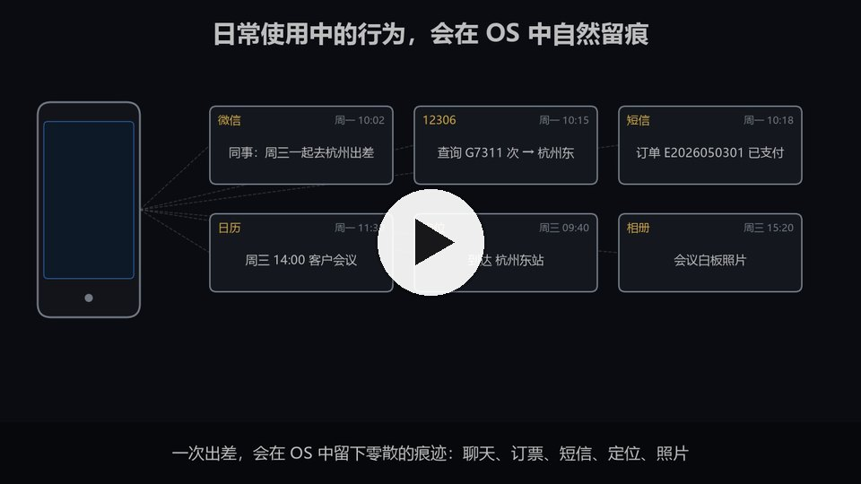

# OS-Memory 使用说明书

**面向操作系统的个人记忆系统**

[English](README.md) · [中文](README.zh.md)

[](docs/assets/hypermemory-demo.mp4)

本说明书面向需要把个人数据接入 OS-Memory、并在自己的应用或 agent 中使用记忆的开发者，依次介绍系统的用途、安装方法、各类数据的接入方式、全部接口，以及如何在 PMM-Bench 上评测。

## 目录

- [第 1 章 简介](#第-1-章-简介)
- [第 2 章 安装](#第-2-章-安装)
- [第 3 章 快速上手](#第-3-章-快速上手)
- [第 4 章 数据接入](#第-4-章-数据接入)
- [第 5 章 接口说明](#第-5-章-接口说明)
- [第 6 章 PMM-Bench 评测](#第-6-章-pmm-bench-评测)
- [第 7 章 故障排查](#第-7-章-故障排查)
- [许可证](#许可证)

---

## 第 1 章 简介

### 1.1 OS-Memory 是什么

> OS-Memory 的 Python 包名为 `hyperos-mem`，导入名为 `hypermem`，主类为 `HyperMemory`。

OS-Memory 是面向操作系统场景的个人记忆系统。它接收设备上产生的各类碎片化记录——屏幕内容、短信、通知、日历、位置、录音、与助手的对话等——把它们整理成一张**可检索的个人记忆图**，并回答"我最近订了哪些火车票""我周三有什么安排"这类关于用户本人的问题。

本仓库提供的实现是 **OS-Memory**，以 Python 库的形式发布：

| 项目 | 内容 |
| --- | --- |
| pip 包名 | `hyperos-mem` |
| 导入名 | `hypermem` |
| 核心接口 | `HyperMemory` 类：`add` / `build` / `search` / `read` |
| 存储 | 单个 SQLite 文件，一个文件对应一个用户 |
| 使用方式 | Python 库，或 MCP 服务器（供 Claude Desktop、Cursor、Claude Code 等客户端直接调用） |

### 1.2 典型用途

- **个人助手的长期记忆**：助手回答问题前先检索用户记忆，把相关事件和事实放进上下文。
- **跨应用的事件串联**：把 12306 的查票截图、支付短信、出行提醒自动归为同一次"出行"事件。
- **用户画像沉淀**：从多次事件中归纳出长期偏好与习惯，例如"经常在周末点川菜外卖"。
- **记忆浏览与审计**：按时间、实体或订单号浏览记忆，并一路追溯到用户提交的原始记录。

### 1.3 工作原理

OS-Memory 把记忆分为五层，自下而上逐层消化：

```text
长期记忆 (long_memory)        跨多个事件归纳出的结论，如"用户近期有杭州出行计划"
  └─ 事件 (event)             一次完整的事，如"查票 + 付款 + 出行"
       ├─ 事实 (fact)         从事件中提炼的一句话结论，附带支撑它的观测
       └─ 观测 (observation)  一条记录解析后的结果：文本、标识、时间、来源应用
            └─ 原始记录 (raw)  通过 add 提交的那一行 JSON，原样保存
```

构建分两条路径完成：

| 路径 | 名称 | 做什么 | 是否调用模型 |
| --- | --- | --- | --- |
| 快路径 | DRED | 按时间顺序把每条观测归入事件：先按订单号等事件标识匹配，再按实体，最后按语义相似度 | 只用嵌入模型，不调 LLM |
| 慢路径 | SAGE | ① 边界巩固：复核事件的合并与拆分；② 为每个事件写标题、摘要并抽取事实；③ 归纳跨事件的长期记忆 | 调用 LLM 和嵌入模型 |

构建完成后，`search` 在这张图上做语义检索，`read` 按条件做结构化浏览。

### 1.4 使用边界

使用前需要了解以下约束：

- **只处理文本。** 系统从不打开图片、音频、视频文件。多模态内容须由上游先转成文本（VLM 描述、OCR、语音转写），见 [4.17 节](#417-多模态数据的预处理)。
- **一个数据库对应一个用户。** `add` 不检查 `user`；库中混入不同的 `user` 时，`build` 会报 `Mixed users in one memory`。此时记录已经写入，只能换一个新库重新写入。
- **成批构建。** 先写入全部记录，再构建一次。构建开始后不能再写入；要记录新的一批数据，需新建一个库。
- **构建需要模型服务。** 构建需要一个 OpenAI 兼容的 LLM 和一个嵌入服务；检索只需要嵌入服务。
- **Windows 不能直接运行。** 数据库的写锁依赖 POSIX 的 `fcntl`，Windows 上无法打开文件型数据库，需在 WSL 中使用。

### 1.5 数据与隐私

OS-Memory 处理的是短信、定位、通知、聊天等高度个人化的数据。使用前请了解数据会去哪里：

| 操作 | 是否联网 | 发送的内容 |
| --- | --- | --- |
| `add`、`read`、`count` | 否 | — |
| `build` | 是 | 观测文本发给嵌入服务；事件及其观测文本发给 LLM，用于生成标题、摘要、事实和长期记忆 |
| `search` | 是 | 查询文本发给嵌入服务 |

- **模型服务。** 数据会发送到你在 `config` 或环境变量中配置的 LLM 和嵌入服务。使用第三方服务前，请确认其数据保留、训练使用和数据存放地域条款；数据库在本地，并不代表全程本地处理。需要完全本地处理时，请自行部署模型服务。
- **本地存储。** 原始记录、观测、事件、事实、长期记忆和向量都以明文保存在 SQLite 数据库中。新建的数据库文件权限为 `0600`（仅当前用户可读写）。请把数据库放在受保护的目录中，并按需使用磁盘加密。
- **删除。** 删除数据库文件及同目录下的 `-wal`、`-shm`、`.writer.lock` 文件即可删除该用户的全部记忆。
- **请求日志。** 设置环境变量 `HYPERMEM_REQUEST_LOG=<文件路径>` 后，每次模型请求的完整内容和回复会以明文追加到该文件，仅用于调试和评测；默认关闭。`pmm_bench` 评测会在输出目录中开启它。
- **MCP 服务器。** MCP 服务器以启动它的用户权限运行，`add` 的 `jsonl_path` 可读取该用户能访问的任何文件。只连接你信任的 MCP 客户端。
- **安全问题** 请按 [SECURITY.md](SECURITY.md) 私下报告。

---

## 第 2 章 安装

### 2.1 环境要求

| 项目 | 要求 |
| --- | --- |
| 操作系统 | Linux 或 macOS；Windows 需使用 WSL |
| Python | 3.10 或更高 |
| 其他 | git |
| LLM 服务 | OpenAI 兼容的 Chat Completions 接口（地址以 `/v1` 结尾），须支持**函数调用**（`tools`）和 **JSON Schema 结构化输出**（`response_format`） |
| 嵌入服务 | OpenAI 兼容的 Embeddings 接口（地址以 `/v1/embeddings` 结尾），需提供模型名和向量维度 |

> 建库与检索必须使用**同一个嵌入服务、同一个模型、同一个维度**，否则检索结果没有意义。

### 2.2 方式一：安装 Python 库

适用于在自己的 Python 代码或 agent 中调用。

**一条命令安装**（不需要 clone 仓库，库和 MCP 服务器一起装好）：

```bash
pip install "hyperos-mem[mcp] @ git+https://github.com/XiaoMi/os-memory.git"
```

在末尾加 `@<版本 tag>`（如 `@v1.0.0`）可固定版本。需要本机装有 git，建议在虚拟环境中执行。

**或者 clone 仓库后安装**：

```bash
git clone https://github.com/XiaoMi/os-memory.git
cd os-memory
python -m venv .venv
source .venv/bin/activate
pip install -e .
```

验证安装：

```bash
python -c "from hypermem import HyperMemory; print('hypermem ok')"
```

输出 `hypermem ok` 表示安装成功。

### 2.3 方式二：安装 MCP 服务器

适用于在 Claude Desktop、Cursor、Claude Code 等 MCP 客户端中直接使用。MCP 服务器提供与库同名的工具：

| 工具 | 对应库方法 | 作用 |
| --- | --- | --- |
| `add(records, jsonl_path, user)` | `add` | 写入记录。`records`（记录数组）和 `jsonl_path`（JSONL 文件路径，须为服务器所在机器上的**绝对路径**）二选一 |
| `build()` | `build` | 构建记忆图。在后台执行并立即返回，进度用 `status` 查看 |
| `search(query, top_k, as_text)` | `search` | 语义检索 |
| `read(...)` | `read` | 结构化浏览 |
| `status()` | `is_started` / `is_built` / `count()` | 数据库与构建状态 |

**第一步：安装**（在 2.2 的基础上加 `[mcp]` 可选依赖；用 2.2 的一条命令安装时已经包含，可跳过安装命令，直接验证）

```bash
pip install -e ".[mcp]"
python -c "from hypermem.mcp_server import build_server; build_server(); print('mcp ok')"
```

输出 `mcp ok` 表示安装成功。

**第二步：在客户端注册服务器**

Claude Desktop 与 Cursor 使用同一段配置：

```json
{
  "mcpServers": {
    "hypermemory": {
      "command": "/absolute/path/to/os-memory/.venv/bin/python",
      "args": ["-m", "hypermem.mcp_server"],
      "env": {
        "HYPERMEM_DB": "/absolute/path/to/memory.db",
        "HYPERMEM_EMBEDDING_URL": "https://your-gateway/v1/embeddings",
        "HYPERMEM_EMBEDDING_MODEL": "<嵌入模型名>",
        "HYPERMEM_EMBEDDING_DIMENSION": "<向量维度>",
        "HYPERMEM_EMBEDDING_API_KEY": "<密钥，服务需要时填写>",
        "HYPERMEM_LLM_BASE_URL": "https://your-gateway/v1",
        "HYPERMEM_LLM_MODEL": "<LLM 模型名>",
        "HYPERMEM_LLM_API_KEY": "<密钥，服务需要时填写>"
      }
    }
  }
}
```

| 客户端 | 配置文件位置 |
| --- | --- |
| Claude Desktop（macOS） | `~/Library/Application Support/Claude/claude_desktop_config.json` |
| Claude Desktop（Windows） | `%APPDATA%\Claude\claude_desktop_config.json` |
| Cursor | `~/.cursor/mcp.json`（全局）或项目下 `.cursor/mcp.json` |

Claude Code 使用命令注册：

```bash
claude mcp add hypermemory \
  -e HYPERMEM_DB=/absolute/path/to/memory.db \
  -e HYPERMEM_EMBEDDING_URL=https://your-gateway/v1/embeddings \
  -e HYPERMEM_EMBEDDING_MODEL=<嵌入模型名> \
  -e HYPERMEM_EMBEDDING_DIMENSION=<向量维度> \
  -e HYPERMEM_LLM_BASE_URL=https://your-gateway/v1 \
  -e HYPERMEM_LLM_MODEL=<LLM 模型名> \
  -- /absolute/path/to/os-memory/.venv/bin/python -m hypermem.mcp_server
```

注册后重启客户端，工具列表中出现 `add`、`build`、`search`、`read`、`status` 即接入成功。

**环境变量说明**

| 变量 | 何时需要 | 说明 |
| --- | --- | --- |
| `HYPERMEM_DB` | 始终 | 数据库文件的绝对路径。文件不存在时由第一次 `add` 创建（所在目录须已存在） |
| `HYPERMEM_EMBEDDING_URL` / `_MODEL` / `_DIMENSION` | `search`、`build` | 嵌入服务地址、模型名、维度 |
| `HYPERMEM_EMBEDDING_API_KEY` | 服务需要时 | 嵌入服务密钥 |
| `HYPERMEM_LLM_BASE_URL` / `_MODEL` | `build` | LLM 服务地址与模型名；只查询、不建库时可省略 |
| `HYPERMEM_LLM_API_KEY` | 服务需要时 | LLM 服务密钥 |

注意事项：

- `command`、`HYPERMEM_DB` 以及 `add` 的 `jsonl_path` 都必须是**绝对路径**。客户端以子进程方式启动服务器，不继承当前目录和已激活的虚拟环境。

**可选的调优变量**（不设置时使用默认值）

| 变量 | 默认值 | 说明 |
| --- | --- | --- |
| `HYPERMEM_LLM_PATH` | `/chat/completions` | LLM 接口路径，拼在 `HYPERMEM_LLM_BASE_URL` 之后 |
| `HYPERMEM_LLM_MAX_TOKENS` | `8192` | 单次回复的最大 token 数 |
| `HYPERMEM_LLM_TIMEOUT` | `180` | 单次 LLM 请求的超时，单位秒 |
| `HYPERMEM_LLM_RETRIES` | `2` | LLM 请求失败后的重试次数 |
| `HYPERMEM_EMBEDDING_BATCH_SIZE` | `32` | 每次嵌入请求包含的文本条数 |
| `HYPERMEM_EMBEDDING_PROTOCOL` | `openai` | 嵌入接口协议，`openai` 或 `tei` |
| `HYPERMEM_EMBEDDING_TIMEOUT` | `60` | 单次嵌入请求的超时，单位秒 |
| `HYPERMEM_EMBEDDING_RETRIES` | `2` | 嵌入请求失败后的重试次数 |

### 2.4 配置模型服务（库方式）

使用 Python 库时，模型服务通过构造参数 `config` 传入。密钥放在环境变量中，配置里只写变量名：

```python
config = {
    "llm": {
        "base_url": "https://your-gateway/v1",        # 以 /v1 结尾
        "model": "<LLM 模型名>",
        "api_key_env": "OPENAI_API_KEY",              # 存放密钥的环境变量名
    },
    "embedding": {
        "url": "https://your-gateway/v1/embeddings",  # 以 /v1/embeddings 结尾
        "model": "<嵌入模型名>",
        "dimension": 1024,
        "api_key_env": "OPENAI_API_KEY",
    },
}
```

| 段 | 必填键 | 可选键（默认值） |
| --- | --- | --- |
| `llm` | `base_url`、`model` | `api_key_env`、`path`（`/chat/completions`）、`max_tokens`（8192）、`timeout`（180 秒）、`retries`（2） |
| `embedding` | `url`、`model`、`dimension` | `api_key_env`、`protocol`（`openai`，也可为 `tei`）、`batch_size`（32）、`timeout`（60 秒）、`retries`（2） |

`embedding.url` 也可以拆成 `base_url` 和 `path`（`path` 默认 `/v1/embeddings`）两项来写。缺少必填键时，构造 `HyperMemory` 会抛 `ValueError`，信息里列出缺的键，例如 `config is missing embedding.dimension`。

`add` 和 `read` 不需要 `config`。`search` 只需要 `embedding` 段；`build` 需要 `llm`、`embedding` 两段都写全，`llm` 段缺失或不全时抛 `ValueError`（`config is missing llm.base_url, llm.model; build needs an LLM service`）。

---

## 第 3 章 快速上手

### 3.1 使用 Python 库

**第一步：把数据整理成记录**。每条记录外层只有 `type`、`timestamp`、`data` 三个字段，其余信息都放在 `data` 里，格式见第 4 章：

```python
records = [
    {"type": "screen", "timestamp": "2026-05-03T09:00:00+08:00",
     "data": {"from_app": "铁路12306",
              "action_description": "在 12306 查询 5月8日 北京南→上海虹桥 G15 二等座余票"}},
    {"type": "sms", "timestamp": "2026-05-03T09:06:00+08:00",
     "data": {"from_app": "短信", "content": "【铁路12306】订单E2026050301已支付，G15次5车08F。",
              "sender": "12306", "anchors": {"order_id": "E2026050301"}}},
    {"type": "calendar", "timestamp": "2026-05-03T10:00:00+08:00",
     "data": {"from_app": "日历", "title": "5月8日 去上海出差"}},
]
```

**第二步：写入、构建、查询**

```python
from hypermem import HyperMemory, ModelServiceError

with HyperMemory("/data/memory/user01.db", config=config) as mem:   # 所在目录须已存在
    print(mem.add(records, user="U01"))            # {'records': 3, 'observations': 3}

    try:
        print(mem.build())                         # {'status': 'built', ...}
    except ModelServiceError as exc:
        print("模型服务故障，构建已暂停：", exc)     # 修复服务后再调用一次 build() 即可续建
        raise

    result = mem.search("我最近订了哪些火车票？")
    print(result["context"])                       # 可直接放进 LLM 上下文的文本
```

### 3.2 使用 MCP 客户端

完成 2.3 节的注册后，在客户端中依次让助手执行：

1. 调用 `add`：记录不多时直接传 `records` 数组；已整理成 JSONL 文件时，传 `jsonl_path`（服务器所在机器上的绝对路径，例如 `/data/memory/records.jsonl`）；
2. 调用 `build`，它会立即返回 `{"status": "running", ...}`，在后台构建；
3. 反复调用 `status`，直到 `build.state` 为 `done` 或 `failed`。构建期间，其他工具都会返回 `A build is running`。若为 `failed` 且 `error` 以 `ModelServiceError` 开头，修好模型服务后再调用一次 `build` 即可续建；
4. 直接提问，例如"我最近订了哪些火车票？"，助手会调用 `search` 回答。

也可以先用 Python 库离线建好数据库，MCP 只用于查询。

---

## 第 4 章 数据接入

### 4.1 接入流程概览

```text
任意数据源 ──► 上游预处理 ──► 整理成记录 ──► add(records) ──► build() ──► search / read
（采集框架、数据库、 截图→VLM 描述    内存中的列表，
  日志、接口……）     图片→OCR        每条一个对象
                   录音→语音转写
```

数据从哪里读、原来是什么格式，由接入方自己决定。接入方负责三件事：

1. **文本化**：把截图、照片、录音等转成文字；
2. **整理成记录**：每条数据整理成 4.2 节的统一结构，选定一种 `type`，填好 `data`；
3. **调用 `add`**：把记录列表直接传给 `add`，不需要先写成文件。

```python
records = [to_record(row) for row in my_source]   # to_record 由接入方按自己的数据编写
mem.add(records, user="U01")
```

`add` 会把每条记录翻译成系统内部使用的格式再交给构建流程，接入方不需要了解内部格式。

### 4.2 记录结构

每条记录的外层只有三个字段，全部必填：

```json
{"type": "类型名", "timestamp": "2026-05-03T09:00:00+08:00", "data": {"...": "..."}}
```

| 字段 | 类型 | 说明 |
| --- | --- | --- |
| `type` | 字符串 | 数据类型，10 种之一，见 4.4 节；决定 `data` 里有哪些专属字段 |
| `timestamp` | 整数或字符串 | 这件事在设备上发生的时间，写法见下表 |
| `data` | 对象 | 通用字段（4.3 节）加该类型的专属字段（4.5 至 4.14 节） |

外层出现这三个以外的字段会报错。

**`timestamp` 的写法**

`timestamp` 支持以下几种格式。无论哪种写法，数据库里都统一存为 Unix 毫秒整数，用于按时间排序。

| 格式 | 示例 | 说明 |
| --- | --- | --- |
| Unix 毫秒 | `1777770000000` | 必须是整数，不能带小数，也不能写成字符串。小于 `100000000000`（1973 年 3 月）的整数会被当作误写成了秒而报错，须乘以 1000 |
| 带时区的时间 | `"2026-05-03T09:00:00+08:00"`、`"2026-05-03T01:00:00Z"` | ISO 8601 格式，按所写的时区理解 |
| 不带时区的时间 | `"2026-05-03 09:00:00"`、`"2026-05-03T09:00"` | 按本机时区理解 |
| 只有日期 | `"2026-05-03"` | 按本机时区当天 0 点理解 |

下面三条记录分别用三种格式写同一个时刻（北京时间 2026 年 5 月 3 日 9 点，本机时区为北京时间），存入数据库后都是 `1777770000000`：

```python
[
    {"type": "sms", "timestamp": 1777770000000, "data": {"content": "您的快递已签收"}},
    {"type": "sms", "timestamp": "2026-05-03T09:00:00+08:00", "data": {"content": "您的快递已签收"}},
    {"type": "sms", "timestamp": "2026-05-03 09:00:00", "data": {"content": "您的快递已签收"}},
]
```

### 4.3 `data` 里的通用字段

以下字段所有类型都可以带，全部可选：

| 字段 | 类型 | 说明 |
| --- | --- | --- |
| `from_app` | 字符串 | 来源应用，即这条数据来自哪个应用，如"铁路12306""微信" |
| `record_id` | 字符串 | 接入方给这条记录的 ID，原样保存，便于回查；同一个库里不能重复 |
| `anchors` | 对象 | 标识，见下表 |
| `entities` | 对象 | 实体，见下表 |
| `latitude` / `longitude` | 数字 | 事情发生时**设备所在的位置**，两个要同时给；纬度须在 -90～90 之间，经度须在 -180～180 之间 |

**`anchors`：标识**。构建时首先按事件标识匹配：同一来源应用（`from_app`）内带相同订单号、交易号或预订号的记录，即使相隔数小时，也会被归入同一事件；快递运单号跨应用也能匹配。

| 键 | 含义 | 作用 |
| --- | --- | --- |
| `order_id` | 订单号 | 事件标识，同一来源应用内匹配 |
| `transaction_id` | 交易号 | 事件标识，同一来源应用内匹配 |
| `reservation_id` | 预订号 | 事件标识，同一来源应用内匹配 |
| `tracking_id` | 快递运单号 | 事件标识，跨应用也能匹配 |
| `phone` | 手机号 | 辅助标识：参与第二级匹配，同一来源应用内号码相同、内容也相近的记录会优先归入同一事件 |
| `email` | 邮箱 | 只保存、可检索，不参与事件归属 |
| `url` | 网址 | 只保存、可检索，不参与事件归属 |

**`entities`：实体**。其中 `contact`、`merchant`、`organizer` 作为第二级匹配依据；`product`、`place` 只保存、可检索，不参与事件归属。

| 键 | 含义 |
| --- | --- |
| `contact` | 联系人 |
| `merchant` | 商家 |
| `product` | 商品 |
| `place` | 地点名称 |
| `organizer` | 组织者 |

说明：

- `anchors` 和 `entities` 的值都必须是非空字符串，只能使用上表中的键。"微信"这类泛称和长度不足 2 个字的实体值会被忽略。
- 正文中"订单号：XXXX""运单号 XXXX"这类写法以及手机号、邮箱、网址会被自动识别。从 `content`、`ocr` 等正文中识别出的订单号会参与事件归属；从 `action_description`、`image_description` 这类 VLM 描述中识别出的只用于检索，不用于事件归属；同一条记录里识别出多个不同的订单号时，也不用于事件归属。上游如果已经掌握结构化的标识，应直接填入 `anchors`，自动识别只是兜底。
- 所有类型的经纬度都是同一个含义：**这件事发生时设备在哪儿**。照片本身的拍摄地点写在 `gallery` 的 `location` 里，见 4.6 节。

### 4.4 支持的数据类型

| `type` | 名称 | 典型数据 | 专属必填字段 | 详见 |
| --- | --- | --- | --- | --- |
| `screen` | 屏幕内容 | 屏幕操作、应用浏览、即时通讯聊天截图 | `action_description` | 4.5 节 |
| `gallery` | 相册 | 拍照、主动截屏、保存或收到的图片 | `image_description` | 4.6 节 |
| `sms` | 短信 | 银行、物流、出行等服务短信，验证码 | `content` | 4.7 节 |
| `push` | 推送通知 | 外卖送达、快递提醒、群消息提醒 | `action`，以及 `title` 或 `content` | 4.8 节 |
| `calendar` | 日历 | 日程、会议提醒、活动预约 | `title` 或 `content` | 4.9 节 |
| `clipboard` | 剪贴板 | 复制或剪切的文字、链接 | `content` | 4.10 节 |
| `position` | 定位 | GPS 定位点、连接的 WiFi | 经纬度或 `ssid` | 4.11 节 |
| `chat` | 用户与助手的对话 | 用户与自己的 agent 之间的一轮问答 | `query` | 4.12 节 |
| `recording` | 录音转写 | 通话、会议、语音备忘录的转写文本 | `transcript` | 4.13 节 |
| `note` | 笔记 | 用户新建、编辑、删除的笔记 | `action`，以及 `title` 或 `content` | 4.14 节 |

`data` 里的文本字段都必须是**非空**字符串：没有值时不要写这个字段，或写 `null`，不要写空串 `""`，否则整批记录都会被拒绝（报 `data.<字段> must be a non-empty string`）。不在字段表中的 `data` 字段会随原始记录保存，但不参与解析和检索。

### 4.5 屏幕内容 `screen`

**用途**：用户在手机屏幕上做了什么，包括屏幕操作、应用切换与浏览，以及微信、QQ 等聊天截图。采集端截屏后，由 VLM 写一句"用户在做什么"的描述。

| `data` 字段 | 必填 | 类型 | 说明 |
| --- | --- | --- | --- |
| `action_description` | 是 | 字符串 | VLM 写的一句话：用户在屏幕上做了什么 |
| `typed_text` | 否 | 字符串 | 用户在输入框里输入的文字，即输入后输入框里的内容；只有打字操作才有 |
| `title` | 否 | 字符串 | 页面标题 |
| `ocr` | 否 | 字符串 | 屏幕上识别出的文字 |
| `image_path` | 否 | 字符串 | 截图文件路径，只用于溯源，系统不读取 |
| 通用字段 | 否 | — | 见 4.3 节 |

**例子：查火车票**

```json
{
  "type": "screen",
  "timestamp": "2026-05-03T09:00:00+08:00",
  "data": {
    "from_app": "铁路12306",
    "action_description": "在 12306 查询 5月8日 北京南→上海虹桥的 G15 次二等座余票",
    "title": "车票查询",
    "ocr": "G15 08:00 北京南 → 12:28 上海虹桥 二等座 有票",
    "image_path": "/sdcard/Screenshots/screenshot_20260503_090000.jpg"
  }
}
```

**例子：微信聊天截图**

```json
{
  "type": "screen",
  "timestamp": "2026-05-03T09:20:00+08:00",
  "data": {
    "from_app": "微信",
    "action_description": "与张三聊天，讨论周三去杭州出差的行程",
    "entities": {"contact": "张三"}
  }
}
```

**例子：在搜索框里打字**

```json
{
  "type": "screen",
  "timestamp": "2026-05-03T09:25:00+08:00",
  "data": {
    "from_app": "美团",
    "action_description": "在美团搜索框中输入餐厅名称",
    "typed_text": "蜀味轩川菜"
  }
}
```

说明：

- 点击坐标、滑动轨迹等手势数据不进入记忆，不需要提交。
- 打字操作要带上 `typed_text`：VLM 的描述通常只说"在搜索框中输入"，用户具体打了什么字只在这个字段里。

### 4.6 相册 `gallery`

**用途**：进入相册的图片，包括用户拍的照片、主动截的屏、保存或收到的图片。和 `screen` 的区别是，`gallery` 记录的是"用户看到或得到了什么内容"，而不是"用户在做什么"，所以系统不会把图片里的内容当作用户本人的行为。

| `data` 字段 | 必填 | 类型 | 说明 |
| --- | --- | --- | --- |
| `image_description` | 是 | 字符串 | VLM 对画面内容的描述 |
| `ocr` | 否 | 字符串 | 图片中识别出的文字 |
| `image_path` | 否 | 字符串 | 图片文件路径，只用于溯源，系统不读取 |
| `captured_at` | 否 | 整数或字符串 | 照片的拍摄时间，写法和 `timestamp` 相同 |
| `location` | 否 | 字符串 | 照片拍摄地点的名称或地址 |
| 通用字段 | 否 | — | 见 4.3 节 |

**例子：今天在家导入了一张去年在杭州拍的照片**

```json
{
  "type": "gallery",
  "timestamp": "2026-05-03T20:10:00+08:00",
  "data": {
    "from_app": "相册",
    "image_description": "西湖断桥边的合影，两个人站在桥头",
    "image_path": "/sdcard/DCIM/Camera/IMG_20250301_153012.jpg",
    "captured_at": "2025-03-01T15:30:12+08:00",
    "location": "杭州西湖断桥",
    "latitude": 30.2590,
    "longitude": 120.1505
  }
}
```

说明：

- **两组时间和地点，说的是两件事**：`timestamp` 和经纬度是这张图**进入相册**的时间和设备位置；`captured_at` 和 `location` 是照片**拍摄**的时间和地点。用手机现拍的照片，两组基本一致；导入的旧照片、别人发来的照片就不一样。
- 时间线上的位置只由 `timestamp` 决定，所以导入的旧照片会排在导入当天。`captured_at` 和 `location` 会写进可检索的文字，例如"拍摄时间：2025-03-01T15:30:12+08:00；拍摄地点：杭州西湖断桥"，问"去年我在杭州拍过什么照片"时能找到。
- 没有 `image_description` 的图片记录会被拒收。只有 OCR 文字、没有画面描述的图片，应由上游补一句描述后再提交。

### 4.7 短信 `sms`

**用途**：收到的短信，如银行、物流、出行等服务短信和验证码短信。

| `data` 字段 | 必填 | 类型 | 说明 |
| --- | --- | --- | --- |
| `content` | 是 | 字符串 | 短信正文 |
| `sender` | 否 | 字符串 | 发送方号码；作为号码标识参与第二级匹配，同一应用下同一号码、内容相近的短信会优先归入同一事件 |
| `sender_name` | 否 | 字符串 | 发送方名称；作为联系人实体，同时给了 `entities.contact` 时以 `sender_name` 为准 |
| 通用字段 | 否 | — | 见 4.3 节 |

**例子**

```json
{
  "type": "sms",
  "timestamp": "2026-05-03T09:06:00+08:00",
  "data": {
    "from_app": "短信",
    "content": "【铁路12306】订单E2026050301已支付，G15次5车08F。",
    "sender": "12306",
    "anchors": {"order_id": "E2026050301"}
  }
}
```

说明：示例中的 `anchors.order_id` 是事件标识。之后同样来自"短信"、带同一订单号的短信（如出票、改签通知）会直接归入同一事件。4.5 节的查票截图来自另一个应用，也没有订单号，它与这条短信只能靠语义相似度关联。

### 4.8 推送通知 `push`

**用途**：应用推送的通知。一条通知可能产生两条记录：通知**到达**，以及用户**点开**通知，`timestamp` 分别是到达和点开的时间。

| `data` 字段 | 必填 | 类型 | 说明 |
| --- | --- | --- | --- |
| `action` | 是 | 字符串 | `receive`（收到）或 `open`（打开），只能取这两个值 |
| `title` | 至少填一个 | 字符串 | 通知标题 |
| `content` | 至少填一个 | 字符串 | 通知正文 |
| 通用字段 | 否 | — | 见 4.3 节，`from_app` 写发出通知的应用 |

**例子：外卖通知，先收到、再打开**

```json
{
  "type": "push",
  "timestamp": "2026-05-03T12:10:00+08:00",
  "data": {
    "from_app": "美团",
    "action": "receive",
    "title": "订单提醒",
    "content": "您的外卖已送达，请及时取餐",
    "anchors": {"order_id": "MT20260503001"}
  }
}
```

```json
{
  "type": "push",
  "timestamp": "2026-05-03T12:12:30+08:00",
  "data": {
    "from_app": "美团",
    "action": "open",
    "title": "订单提醒",
    "content": "您的外卖已送达，请及时取餐",
    "anchors": {"order_id": "MT20260503001"}
  }
}
```

说明：`action` 为 `open` 时，系统会在可检索的文字里记下"用户打开了这条通知"。两条记录带了同一个订单号，构建时会归进同一个事件。

### 4.9 日历 `calendar`

**用途**：日程、会议提醒、活动预约。

| `data` 字段 | 必填 | 类型 | 说明 |
| --- | --- | --- | --- |
| `title` | 至少填一个 | 字符串 | 标题 |
| `content` | 至少填一个 | 字符串 | 备注 |
| `start_time` | 否 | 整数或字符串 | 开始时间；写法和 `timestamp` 相同 |
| `end_time` | 否 | 整数或字符串 | 结束时间；写法同上，不能早于 `start_time` |
| `remind_time` | 否 | 整数或字符串 | 提醒时间；写法同上 |
| `calendar_type` | 否 | 字符串 | 日历类型，如"工作""个人""生日" |
| 通用字段 | 否 | — | 见 4.3 节 |

**例子：5 月 3 日建了一个 5 月 8 日去上海出差的日程**

```json
{
  "type": "calendar",
  "timestamp": "2026-05-03T10:00:00+08:00",
  "data": {
    "from_app": "日历",
    "title": "去上海出差",
    "content": "带上合同，下午拜访客户",
    "start_time": "2026-05-08T09:00:00+08:00",
    "end_time": "2026-05-08T18:00:00+08:00",
    "remind_time": "2026-05-08T08:00:00+08:00",
    "calendar_type": "工作",
    "entities": {"organizer": "李四"}
  }
}
```

说明：

- `timestamp` 是这条日程**创建**的时间；`start_time`、`end_time`、`remind_time` 是日程**本身**的时间。
- 后面这三个时间和 `calendar_type` 不参与排序，会写进可检索的文字，例如"开始时间：2026-05-08T09:00:00+08:00；结束时间：2026-05-08T18:00:00+08:00；提醒时间：2026-05-08T08:00:00+08:00；日历类型：工作"，问"5 月 8 日我有什么安排"时能找到。
- 采集端目前只提供 `title`、`content` 和 `remind_time`，开始时间、结束时间和日历类型有就填，没有可以不填。

### 4.10 剪贴板 `clipboard`

**用途**：用户复制或剪切的文字、链接。

| `data` 字段 | 必填 | 类型 | 说明 |
| --- | --- | --- | --- |
| `content` | 是 | 字符串 | 复制或剪切的内容 |
| `action` | 否 | 字符串 | `copy`（复制）或 `cut`（剪切）；不知道是哪种时不填 |
| 通用字段 | 否 | — | 见 4.3 节，`from_app` 写在哪个应用里复制的 |

**例子**

```json
{
  "type": "clipboard",
  "timestamp": "2026-05-03T10:30:00+08:00",
  "data": {
    "from_app": "淘宝",
    "action": "copy",
    "content": "https://example.com/item/123 便携相机 补光棒",
    "anchors": {"url": "https://example.com/item/123"}
  }
}
```

说明：复制的内容不一定是用户本人的观点或事实，系统不会仅凭剪贴板内容推断用户偏好。

### 4.11 定位 `position`

**用途**：本身就是一条定位的数据，没有别的内容，如 GPS 定位点、连上的 WiFi。其他类型记录上附带的设备位置，用通用字段 `latitude` / `longitude` 表示，不需要另外提交 `position` 记录。

| `data` 字段 | 必填 | 类型 | 说明 |
| --- | --- | --- | --- |
| `latitude` / `longitude` | 和 `ssid` 至少给一个 | 数字 | 定位的经纬度，两个要同时给；纬度须在 -90～90 之间，经度须在 -180～180 之间 |
| `ssid` | 和经纬度至少给一个 | 字符串 | 连接的 WiFi 名称 |
| `location` | 否 | 字符串 | 地点名称或地址 |
| `accuracy` | 否 | 数字 | 定位精度，单位米，不能为负数；只在给了经纬度时生效，只给 `ssid` 时会被忽略 |
| 通用字段 | 否 | — | 见 4.3 节 |

**例子：GPS 定位点**

```json
{
  "type": "position",
  "timestamp": "2026-05-03T11:00:00+08:00",
  "data": {
    "latitude": 31.2304,
    "longitude": 121.4737,
    "accuracy": 15,
    "location": "上海人民广场"
  }
}
```

**例子：连上家里的 WiFi**

```json
{
  "type": "position",
  "timestamp": "2026-05-03T19:00:00+08:00",
  "data": {"ssid": "Home_5G"}
}
```

说明：定位记录本身没有文字，系统会合成一句可检索的文字，如"位置：上海人民广场"（没有 `location` 时写经纬度）或"连接 WiFi：Home_5G"。同时给了经纬度和 `ssid` 时，存为两条观测。

### 4.12 用户与助手的对话 `chat`

**用途**：用户和自己的 agent 之间的对话，一轮问答对应一条记录。手机里和别人的聊天（微信、QQ 截图）不属于此类型，按 4.5 节的 `screen` 接入。

| `data` 字段 | 必填 | 类型 | 说明 |
| --- | --- | --- | --- |
| `query` | 是 | 字符串 | 用户说的话 |
| `answer` | 否 | 字符串 | 助手的回答 |
| `session_id` | 否 | 字符串 | 会话 ID，同一次会话的多轮对话带同一个值 |
| 通用字段 | 否 | — | 见 4.3 节，`from_app` 写 agent 的名称 |

**例子：一次会话里的两轮**

```json
{
  "type": "chat",
  "timestamp": "2026-05-03T11:46:40+08:00",
  "data": {
    "from_app": "MyAssistant",
    "session_id": "s-20260503-01",
    "query": "我不吃香菜，帮我找家附近的川菜馆",
    "answer": "为你找到蜀味轩，步行 8 分钟，已备注不放香菜"
  }
}
```

```json
{
  "type": "chat",
  "timestamp": "2026-05-03T11:48:10+08:00",
  "data": {
    "from_app": "MyAssistant",
    "session_id": "s-20260503-01",
    "query": "帮我订今晚 7 点两个人的位子",
    "answer": "已为你预订蜀味轩今晚 19:00 两位",
    "anchors": {"reservation_id": "SW20260503-019"}
  }
}
```

说明：

- 系统在文字前标明说话人：`query` 写成"用户：……"，`answer` 写成"助手：……"，构建时据此区分用户本人说的话和助手的回答。
- 一条带 `answer` 的记录存为两条观测，`answer` 排在 `query` 之后 1 毫秒，以保持问答顺序。
- 带同一个 `session_id`（且 `from_app` 相同）的多轮对话，即使相隔较久，构建时也会优先归入同一个事件；但内容不相关时仍会分成不同的事件。

### 4.13 录音转写 `recording`

**用途**：通话录音、会议录音、语音备忘录转成的文字。`timestamp` 是录音开始的时间。

| `data` 字段 | 必填 | 类型 | 说明 |
| --- | --- | --- | --- |
| `transcript` | 是 | 列表 | 转写内容，至少 1 段；整段转写就只放 1 段 |
| `transcript[].text` | 是 | 字符串 | 这一段说的话 |
| `transcript[].offset_ms` | 是 | 整数 | 这一段距离录音开始的毫秒数；整段转写写 `0` |
| `transcript[].speaker` | 是 | 字符串或 `null` | 说话人：`user` 表示用户本人，其他值（如"张三"）表示对方，不知道是谁时写 `null` |
| `audio_path` | 否 | 字符串 | 录音文件路径，只用于溯源，系统不读取 |
| 通用字段 | 否 | — | 见 4.3 节 |

`transcript` 里每一段都用同一个结构，三个字段都要写。

**例子：通话录音（分段，2 段）**

```json
{
  "type": "recording",
  "timestamp": "2026-05-03T09:30:00+08:00",
  "data": {
    "from_app": "通话录音",
    "audio_path": "/sdcard/MIUI/sound_recorder/call_rec/20260503_093000.mp3",
    "entities": {"contact": "张三"},
    "transcript": [
      {"text": "下周三我去杭州出差", "offset_ms": 0, "speaker": "user"},
      {"text": "好的，我帮你订周三早上的高铁", "offset_ms": 5000, "speaker": "张三"}
    ]
  }
}
```

**例子：语音备忘录（整段，1 段）**

```json
{
  "type": "recording",
  "timestamp": "2026-05-03T09:40:00+08:00",
  "data": {
    "from_app": "录音机",
    "transcript": [{"text": "下周三去杭州出差，记得带合同", "offset_ms": 0, "speaker": null}]
  }
}
```

说明：

- 每一段存为一条观测，时间为 `timestamp` 加上该段的 `offset_ms`，因此 `add` 返回的观测数可能大于记录数；同一条录音的原始记录只保存一份。
- 系统在文字前标明说话人，如"用户：……""张三：……"；`speaker` 为 `null` 的段落不标。
- `speaker` 不是 `user` 时，会被当作联系人实体；同时给了 `entities.contact` 时以 `speaker` 为准。

### 4.14 笔记 `note`

**用途**：用户在笔记应用里新建、编辑、删除的笔记。笔记是用户本人写的内容。

| `data` 字段 | 必填 | 类型 | 说明 |
| --- | --- | --- | --- |
| `action` | 是 | 字符串 | `create`（新增）、`edit`（编辑）或 `delete`（删除） |
| `title` | 至少填一个 | 字符串 | 笔记标题 |
| `content` | 至少填一个 | 字符串 | 笔记正文；`edit` 时为编辑后的全文，`delete` 时为被删除笔记的内容 |
| 通用字段 | 否 | — | 见 4.3 节 |

**例子**

```json
{
  "type": "note",
  "timestamp": "2026-05-03T21:30:00+08:00",
  "data": {
    "from_app": "笔记",
    "action": "edit",
    "title": "杭州出差",
    "content": "周三去杭州，带上合同；我不吃香菜，订餐时注意"
  }
}
```

说明：

- **同一篇笔记，一次编辑只提交最后一版。** 采集端在用户边写边改时会反复保存全文，一篇笔记可能产生几十上百条几乎相同的记录。接入方应在调用 `add` 之前，把连续一段时间内（例如 30 分钟内）对同一篇笔记的编辑合并成一条，只保留最后一个版本；隔一段时间再改的，作为新的一次编辑单独提交。
- 系统会在可检索的文字里记下动作，如"用户编辑了这条笔记"。

### 4.15 批量写入

**传入列表**：最常见的方式，把整理好的记录放在一个列表里：

```python
result = mem.add(records, user="U01")
print(result)   # {'records': 120, 'observations': 126}
```

**传入生成器**：数据量很大时，传生成器可以边读边写，不必把全部记录放进内存：

```python
def read_rows():
    for row in my_database.iter_rows():        # 接入方自己的数据源
        yield to_record(row)

mem.add(read_rows(), user="U01")
```

**已有 JSONL 文件**：自己逐行读取即可：

```python
import json

with open("records.jsonl", encoding="utf-8") as f:
    mem.add((json.loads(line) for line in f if line.strip()), user="U01")
```

写入规则：

- **整批校验**：任意一条记录不合法时，`add` 报错并指出是第几条（如 `records[12]: type 'sms' requires data.content`），**整批回滚**，数据库不会留下一半的数据。
- **原样保存**：每条记录按提交时的内容保存在数据库中（`timestamp` 统一转为毫秒），可通过 `read(include_raw=True)` 取回。
- **ID 去重**：带 `record_id` 的记录，如果同一个库里已有相同的 `record_id`，报错 `duplicate record_id`。
- **顺序不限**：记录之间的顺序不影响结果，构建时按时间排序。
- **多次写入**：构建开始前可以多次调用 `add`。

### 4.16 文本长度

每条观测参与检索的文本（各描述、正文、OCR、转写等字段拼合后）最多保留 6000 个字符。过长的文档应由上游先切分成多条记录或做摘要。

### 4.17 多模态数据的预处理

| 原始数据 | 上游处理 | 接入类型与 `data` 字段 |
| --- | --- | --- |
| 屏幕截图、屏幕操作 | VLM 描述"用户在做什么"，可附 OCR | `screen`：`action_description`，可选 `ocr` |
| 照片、主动截屏、收到的图片 | VLM 描述画面，OCR 识别文字 | `gallery`：`image_description`、`ocr`、`image_path` |
| 聊天截图（微信、QQ 等） | VLM 概括聊天内容 | `screen`：`action_description`，联系人放进 `entities.contact` |
| 通话、会议录音 | 语音转写，能区分说话人时按段输出 | `recording`：`transcript` |
| 视频 | 抽帧描述或语音转写 | 按内容选 `gallery` 或 `recording` |

媒体文件路径可以随记录提交，用于事后溯源，但系统不会打开这些文件。

### 4.18 接入检查清单

提交前逐项确认：

- [ ] 每条记录外层只有 `type`、`timestamp`、`data` 三个字段；
- [ ] `type` 是 10 种类型之一，`data` 中该类型的必填字段都已填写且不为空；
- [ ] 没有值的文本字段已省略或写成 `null`，没有写成空串 `""`；
- [ ] `timestamp` 是整数**毫秒**（不是秒），或 ISO 8601 时间字符串；不带时区的时间会按本机时区理解；
- [ ] 经纬度是数字、成对出现且在取值范围内，表示事情发生时设备所在的位置；
- [ ] `push` 和 `note` 填了 `action`，取值是规定的单词原形；
- [ ] `recording` 的每一段都写了 `text`、`offset_ms`、`speaker`；
- [ ] 同一篇笔记的连续编辑已合并，只保留最后一版；
- [ ] 能拿到订单号、运单号等标识时，已填入 `anchors`；
- [ ] 带 `record_id` 的记录，`record_id` 在同一个库里不重复；
- [ ] 一个库只写入一个用户的数据（`add` 不检查，混入多个用户要到 `build` 时才报错）。

---

## 第 5 章 接口说明

本章逐一介绍 Python 库和 MCP 服务器提供的全部接口：参数、返回值和可能抛出的异常。

### 5.1 接口总览

**Python 库**（`from hypermem import HyperMemory, ModelServiceError, format_memories`）

| 接口 | 类别 | 作用 | 调用的模型服务 | 可用时机 |
| --- | --- | --- | --- | --- |
| `HyperMemory(db_path, config, source_id)` | 构造 | 打开或新建一个记忆库 | 无 | — |
| `add(records, user)` | 方法 | 写入一批记录 | 无 | 构建开始前 |
| `build(progress)` | 方法 | 构建记忆图，或续建未完成的构建 | LLM + 嵌入 | 写入记录后 |
| `search(query, top_k, as_text)` | 方法 | 用自然语言语义检索记忆 | 嵌入 | 构建完成后 |
| `read(...)` | 方法 | 按事件 ID、时间、实体、标识结构化浏览 | 无 | 任何时候 |
| `is_started` | 属性 | 构建是否已开始 | 无 | 任何时候 |
| `is_built` | 属性 | 构建是否已完成 | 无 | 任何时候 |
| `count()` | 方法 | 各类数据的条数 | 无 | 任何时候 |
| `close()` | 方法 | 关闭数据库连接 | 无 | — |
| `format_memories(result)` | 函数 | 把 `search` 的结果渲染成文本 | 无 | — |
| `ModelServiceError` | 异常 | 模型服务故障 | — | — |

**MCP 服务器**的工具与库的方法同名、参数相同，见 [5.11 节](#511-mcp-工具接口)。

**调用顺序**

```text
HyperMemory(...)  ──►  add(...) × N  ──►  build()  ──►  search(...) / read(...) × N  ──►  close()
                      构建开始前可多次      可续建        构建完成后可反复调用
```

**线程**：一个 `HyperMemory` 对象只能在创建它的线程中使用，所有方法都是同步调用。

### 5.2 `HyperMemory(...)`：打开记忆库

```python
HyperMemory(db_path=":memory:", *, config=None, source_id=None)
```

| 参数 | 类型 | 默认值 | 说明 |
| --- | --- | --- | --- |
| `db_path` | `str` / `Path` | `":memory:"` | SQLite 数据库文件路径。文件不存在时新建；`":memory:"` 表示临时库，关闭后数据丢失 |
| `config` | `dict` | `None` | 模型服务配置，格式见 [2.4 节](#24-配置模型服务库方式)。`build`、`search` 需要；`add`、`read` 不需要 |
| `source_id` | `str` | 由路径生成 | 观测 ID 的命名空间，一般不需要设置 |

```python
mem = HyperMemory("/data/memory/user01.db", config=config)
```

**异常**：`config` 缺少 `embedding` 段或其必填键，或嵌入地址不是 OpenAI 兼容格式时抛 `ValueError`。只查询、不建库的库可以省略 `llm` 段，`build` 时才检查。缺少必填键时，信息会列出缺的键，例如 `config is missing embedding.dimension`。

### 5.3 `add`：写入记录

```python
mem.add(records, *, user=None) -> dict
```

| 参数 | 类型 | 说明 |
| --- | --- | --- |
| `records` | 记录列表，或任意可迭代对象（如生成器） | 每个元素是一条记录（`dict`），格式见第 4 章 |
| `user` | `str` | 记录归属的用户 ID。一个库只能有一个用户；`add` 不检查，混入多个用户时 `build` 抛 `ValueError` |

**返回值**：`{"records": 记录数, "observations": 观测数}`。带 `answer` 的 `chat`、多段的 `recording`、同时有经纬度和 `ssid` 的 `position` 会产生多条观测，所以观测数可能大于记录数。

**行为**：

- 只在本地写入，不发起任何网络请求；
- 逐条校验、逐条写入；传入生成器时边读边写，数据量不受内存限制；
- 任意一条出错时，本次传入的全部记录回滚；
- `timestamp` 统一转为 Unix 毫秒后存入数据库；
- 构建开始前可以多次调用。

**异常**：

| 异常 | 触发条件 |
| --- | --- |
| `ValueError` | 某条记录不合法：外层有 `type`、`timestamp`、`data` 以外的字段、类型未知、`timestamp` 写法无法识别、缺少必填字段、字段类型或取值不对、`record_id` 重复。信息格式为 `records[序号]: 原因` |
| `TypeError` | 传入的不是记录列表，例如误传了文件路径。信息中附读取 JSONL 文件的写法 |
| `RuntimeError` | 构建已经开始（`is_started` 为 `True`），信息为 `This memory is already built or being built…` |

```python
result = mem.add(records, user="U01")
print(f"写入 {result['records']} 条记录，{result['observations']} 条观测")
```

### 5.4 `build`：构建记忆图

```python
mem.build(*, progress=None) -> dict
```

| 参数 | 类型 | 说明 |
| --- | --- | --- |
| `progress` | 可调用对象 | 可选的进度回调，以 `progress(info)` 的形式调用，`info` 为 `dict` |

构建依次运行 DRED 和 SAGE 的三个步骤，调用 LLM 和嵌入服务，数据量较大时可能需要数分钟或更久。

**进度回调的 `info`**

| `info["stage"]` | 阶段 | 主要字段 |
| --- | --- | --- |
| `"dred"` | DRED 事件归属，每处理 100 条观测回调一次 | `processed`（已处理观测数）、`observations`（总数）、`events`（当前事件数） |
| `"sage_boundary"` | SAGE 边界巩固 | `phase`（子步骤，如 `adjudicate`、`split`、`stitch`、`wiki`）、`step` |
| `"sage_event_tools"` | SAGE 事件标题、摘要与事实抽取 | `pass`（轮次）、`processed_in_pass`、`scheduled_in_pass` |

**返回值**

```python
{
    "status": "built",
    "resumed": False,          # True 表示这次是续建
    "observations": 3,         # 观测总数
    "events": 2,               # 事件总数
    "dred": {"events": 2},     # DRED 阶段得到的事件数
    "sage": {"status": "complete"}
}
```

`sage.status` 为 `complete` 表示全部任务成功；为 `complete_with_skipped_failures` 表示有任务因模型回复无效而被跳过，构建仍然有效。

**异常**

| 异常 | 触发条件 | 处理 |
| --- | --- | --- |
| `ModelServiceError` | LLM 或嵌入服务不可达、超时、过载，或拒绝所配置的密钥、地址、模型（HTTP 401/403/404/405） | 修复服务后再调用一次 `build()`，从中断处续建 |
| `RuntimeError` | 未传 `config`；没有写入任何记录；已经构建完成；SAGE 完成检查未通过；模型服务返回其他 HTTP 错误（如 400），信息为 `Model service HTTP <状态码>` | 按错误信息处理 |
| `ValueError` | `config` 的 `llm` 段缺失或不全（`config is missing llm.base_url, llm.model; build needs an LLM service`）；库中出现多个用户（`Mixed users in one memory`）；嵌入模型或维度与上次构建不同（`Embedding model or dimension changed…`）；构建方法的其他参数与上次不同（`Different settings require a new memory run`） | 每个用户使用单独的库；换了嵌入模型或维度时须新建一个库重新写入 |

**模型服务故障与续建**

`build()` 抛出 `ModelServiceError` 时：

- 已完成的工作全部保留，任何任务的重试次数都不会因这次故障而消耗，已算好的向量也会保存；
- 故障发生在 SAGE 阶段（LLM 出错）时，数据库处于"已开始、未完成"状态：`is_started` 为 `True`，`is_built` 为 `False`，此时不能 `add`，`search` 会报错；
- 嵌入服务在 DRED 阶段就出错（常见于嵌入地址、密钥或模型配错）时，`is_started` 仍为 `False`，此时还可以 `add`；
- 两种情况都只需修复服务后对同一个数据库再调用一次 `build()`，构建从中断处继续。前一种情况返回值中 `resumed` 为 `True`，后一种为 `False`。

续建时可以修改模型服务的配置：LLM 的地址、模型、密钥、超时，以及嵌入服务的地址、密钥、批大小等，新的配置会直接生效。嵌入模型（`embedding.model`）和维度（`embedding.dimension`）不能改：已存的向量无法复用，`build()` 会抛 `ValueError`（`Embedding model or dimension changed…`），须新建一个库重新写入。

进程崩溃或被中断后，同样可以再调用 `build()` 续建。

模型**有回复但内容无效**（格式不符、证据对不上等）不属于服务故障：该任务在自身的重试次数内重试，仍失败则跳过并记录，构建继续完成。

```python
from hypermem import ModelServiceError

try:
    report = mem.build(progress=lambda info: print(info["stage"], info.get("processed", "")))
except ModelServiceError as exc:
    print("模型服务故障，构建已暂停：", exc)   # 修复服务后再调用一次 mem.build()
```

### 5.5 `search`：语义检索

```python
mem.search(query, *, top_k=20, as_text=True) -> dict
```

| 参数 | 类型 | 默认值 | 说明 |
| --- | --- | --- | --- |
| `query` | `str` | — | 自然语言问题，中文或英文，不能为空 |
| `top_k` | `int` | `20` | 最多返回的事件数，正整数。召回的事件多于 `top_k` 时，保留得分最高的 `top_k` 个 |
| `as_text` | `bool` | `True` | 是否生成 `context` 文本 |

**返回值**

```python
{
    "query": "我去杭州的高铁订好了吗？",
    "events": [
        {
            "event_id": "E-...",
            "score": 0.82,
            "title": "预订杭州高铁",
            "summary": "……",
            "time_span": ["2026-05-03T01:33:20+00:00", "2026-05-03T01:40:00+00:00"],
            "facts": [{"text": "已预订下周三去杭州的高铁", "support": ["O-...", "O-..."]}]
        }
    ],
    "long_memories": [
        {"memory_id": "LM-...", "score": 0.75, "text": "用户近期有杭州出行计划", "evidence": ["O-..."]}
    ],
    "scores": {"E-...": 0.82, "LM-...": 0.75},
    "context": "[长期记忆] 用户近期有杭州出行计划\n[事件] 预订杭州高铁（…）\n  摘要：……\n  事实：……"
}
```

| 字段 | 说明 |
| --- | --- |
| `events` | 召回的事件：先按得分取前 `top_k` 个，再按事件开始时间排序返回 |
| `events[].score` | 检索得分，越大越相关 |
| `events[].time_span` | 事件的起止时间，UTC 的 ISO 8601 格式 |
| `events[].facts[].support` | 支撑该事实的观测 ID，可用于溯源 |
| `long_memories` | 召回的长期记忆，`evidence` 为支撑它的观测 ID |
| `scores` | 所有召回节点的得分表 |
| `context` | 把长期记忆和事件拼成的文本，可直接放进 LLM 上下文；`as_text=False` 时没有此字段 |

检索召回的是**事件、事实和长期记忆**，而不是提交的单条记录。

**异常**

| 异常 | 触发条件 |
| --- | --- |
| `RuntimeError` | 未传 `config`；构建尚未完成（信息以 `Call build() before search()` 开头） |
| `ValueError` | `query` 为空，或 `top_k` 不是正整数 |
| `ModelServiceError` | 嵌入服务故障 |

```python
result = mem.search("我最近订了哪些火车票？", top_k=10)
prompt = f"根据以下用户记忆回答问题：\n{result['context']}\n\n问题：我最近订了哪些火车票？"
```

### 5.6 `read`：结构化浏览

```python
mem.read(*, event_id=None, start=None, end=None, entity=None, anchor=None, limit=20,
         include_facts=True, include_observations=False, include_raw=False,
         include_long_memories=False) -> dict
```

`read` 按条件直接查询，不调用任何模型，任何时候都能调用。事件在 `build` 中生成，构建后 `read` 才能看到事件；构建前返回空列表。构建中途停下时（已开始、未完成），能看到事件，但标题、摘要、事实为空。

**筛选参数**

| 参数 | 类型 | 默认值 | 说明 |
| --- | --- | --- | --- |
| `event_id` | `str` | `None` | 按 ID 读取一个事件，此时忽略其他筛选条件；ID 不存在时返回空结果 |
| `start` | `str` / `datetime` / `date` / `int` | `None` | 只保留开始时间不早于该时间的事件；`int` 为 Unix 毫秒 |
| `end` | `str` / `datetime` / `date` / `int` | `None` | 只保留开始时间不晚于该时间的事件；`int` 为 Unix 毫秒 |
| `entity` | `str` | `None` | 只保留实体中包含该字符串的事件（子串匹配），不区分大小写 |
| `anchor` | `str` | `None` | 只保留标识值中有与之**完全相同**的值的事件，如订单号 |
| `limit` | `int` | `20` | 最多返回的事件数 |

多个筛选条件同时给出时取交集。

**`start` / `end` 的写法**

| 写法 | 示例 | 含义 |
| --- | --- | --- |
| 日期 | `"2026-05-03"` | 作为 `start` 表示当天 0 点起；作为 `end` 表示**包含当天全天** |
| 日期和时间 | `"2026-05-03 08:30"` 或 `"2026-05-03T08:30"` | 精确到分钟或秒 |
| 带时区的时间 | `"2026-05-03T08:30+08:00"`、`"2026-05-03T00:30Z"` | 按所写的时区理解 |
| Python 对象 | `datetime(2026, 5, 3, 8, 30)`、`date(2026, 5, 3)` | 与对应的字符串写法相同 |

没写时区的时间按**本机时区**理解；使用 MCP 时，指运行 MCP 服务器的机器的时区。MCP 的 `read` 工具只接受字符串写法。

**层级参数**：决定每个事件附带哪些层的内容。

| 参数 | 默认值 | 附带内容 |
| --- | --- | --- |
| `include_facts` | `True` | 事件的事实，构建完成后才有 |
| `include_observations` | `False` | 组成事件的观测 |
| `include_raw` | `False` | 通过 `add` 提交的原始记录，同一条原始记录只出现一次 |
| `include_long_memories` | `False` | 与返回事件相关的长期记忆，构建完成后才有 |

**返回值**

```python
{
    "events": [
        {
            "event_id": "E-...",
            "time_span": ["2026-05-03T01:00:00+00:00", "2026-05-03T01:06:00+00:00"],
            "state": "transaction",                 # DRED 判定的事件状态
            "entities": ["铁路12306", "G15"],
            "anchors": {"order_id": ["E2026050301"]},
            "confidence": 0.92,
            "title": "预订北京到上海高铁",            # 构建前为 None
            "summary": "……",                       # 构建前为 None
            "facts": [{"fact_id": "...", "text": "...", "support": ["O-..."]}],           # include_facts
            "observations": [{"observation_id": "O-...", "timestamp": "...",
                              "source": "短信", "anchors": {...}}],                        # include_observations
            "raw_records": [{"raw_id": "R-...", "record": {"type": "sms", ...}}]          # include_raw
        }
    ],
    "long_memories": [{"memory_id": "LM-...", "text": "...", "confidence": "high",
                       "support_events": ["E-..."], "evidence_ids": ["O-..."]}],         # include_long_memories
    "total": 5
}
```

| 字段 | 说明 |
| --- | --- |
| `events` | 符合条件的事件，按开始时间排序，最多 `limit` 个 |
| `total` | 符合条件的事件总数（`limit` 截断前） |
| `long_memories` | 未开启 `include_long_memories` 时为空列表 |

**异常**：`start` / `end` 的写法无法识别时抛出 `ValueError`，信息中附正确写法示例。

```python
mem.read(anchor="E2026050301", include_raw=True)              # 某订单相关的全部事件及原始记录
mem.read(start="2026-05-03", end="2026-05-03")                 # 2026 年 5 月 3 日全天的事件
mem.read(start="2026-05-03 08:00", end="2026-05-03 12:00")     # 当天上午 8 点到 12 点开始的事件
mem.read(entity="张三", include_observations=True)             # 涉及某人的事件及其观测
```

### 5.7 `is_started` / `is_built`：构建状态

两者都是只读属性，返回 `bool`：

| `is_started` | `is_built` | 状态 | 可做的操作 |
| --- | --- | --- | --- |
| `False` | `False` | 尚未构建 | `add`、`build`、`read`（返回空列表） |
| `True` | `False` | 构建中，或上次构建未完成 | `build`（续建）、`read` |
| `True` | `True` | 构建完成 | `search`、`read` |

### 5.8 `count`：数据统计

```python
mem.count() -> dict
```

返回各类数据的条数：

| 键 | 含义 |
| --- | --- |
| `raw_records` | 提交的原始记录数 |
| `observations` | 观测数 |
| `observation_features` | 已计算特征的观测数 |
| `events` | 事件数 |
| `event_relations` | 事件间关系数 |

### 5.9 `close` 与上下文管理

`close()` 关闭数据库连接。推荐使用 `with` 语句，退出时自动关闭：

```python
with HyperMemory("/data/memory/user01.db", config=config) as mem:
    result = mem.search("我周三有什么安排？")
```

### 5.10 `format_memories`：渲染检索结果

```python
from hypermem import format_memories

text = format_memories(result)   # result 为 search 的返回值
```

把检索结果渲染成与 `context` 相同格式的文本。适用于先用 `as_text=False` 拿到结构化结果、筛选或改写后再生成文本的场景。文本格式为：

```text
[长期记忆] 用户近期有杭州出行计划
[事件] 预订杭州高铁（2026-05-03T01:33:20+00:00 ~ 2026-05-03T01:40:00+00:00）
  摘要：……
  事实：已预订下周三去杭州的高铁
```

### 5.11 MCP 工具接口

MCP 工具的名称、参数与库的方法一致，返回值为相同结构的 JSON。出错时工具返回错误信息：库抛出的 `ValueError`、`RuntimeError`（含 `ModelServiceError`）原样转为错误信息，其他异常只显示 `Error executing tool`；此外 MCP 还会检查路径是否为绝对路径、所需的环境变量是否齐全。

| 工具 | 参数 | 返回值 | 说明 |
| --- | --- | --- | --- |
| `add` | `records` 或 `jsonl_path`（二选一）、`user` | `{"records": N, "observations": M}` | `records` 为记录数组；`jsonl_path` 为 JSONL 文件的绝对路径，每行一条记录，出错时报 `文件路径:行号`，适合大批量数据。数据库文件不存在时新建 |
| `build` | 无 | `{"status": "running", "observations": N}` | 在后台构建并立即返回 |
| `search` | `query`、`top_k`、`as_text` | 同 5.5 节 | — |
| `read` | 同 5.6 节，`start` / `end` 用字符串 | 同 5.6 节 | — |
| `status` | 无 | 见下文 | 只读 |

**`status` 的返回值**

```python
{
    "db": "/data/memory/user01.db",
    "exists": True,                  # 数据库文件是否存在
    "is_started": True,
    "is_built": False,
    "counts": {"raw_records": 120, "observations": 126, ...},   # 同 5.8 节；数据库文件不存在时为 None
    "services": {"search": True, "build": True},                # 已配置的模型服务允许哪些工具
    "build": {"state": "running", "progress": {...}}            # 本次服务进程中最近一次后台构建
}
```

`build` 字段的取值：

| 值 | 含义 |
| --- | --- |
| `None` | 本次服务进程中尚未发起过构建 |
| `{"state": "running", "progress": {...}}` | 正在构建，`progress` 为最近一次进度回调的内容。此时只返回 `db` 和 `build` 两个字段 |
| `{"state": "done", "report": {...}}` | 构建完成，`report` 同 5.4 节的返回值 |
| `{"state": "failed", "error": "...", "progress": {...}}` | 构建失败，`progress` 为失败前最后一次进度。`error` 以 `ModelServiceError` 开头时，修复服务后再调用一次 `build` 即可续建 |

构建进行期间，除 `status` 外的工具都会返回 `A build is running` 错误，构建结束后再调用。

### 5.12 异常一览

| 异常 | 来源 | 含义 |
| --- | --- | --- |
| `ValueError` | `add`、`read`、`search`、`build`、构造 | 输入不合法：记录格式错误、时间写法无法识别、查询为空、配置格式错误或缺少必填键；`build` 时库中出现多个用户、嵌入模型或维度与上次构建不同 |
| `RuntimeError` | `add`、`build`、`search` | 调用时机不对：构建开始后写入、未构建就检索、重复构建、缺少配置；或模型服务返回了 `ModelServiceError` 之外的 HTTP 错误（如 400），信息为 `Model service HTTP <状态码>` |
| `ModelServiceError` | `build`、`search` | 模型服务故障：不可达、超时、过载（重试耗尽），或返回 HTTP 401/403/404/405。它是 `RuntimeError` 的子类，可单独捕获 |
| `TypeError` | `add` | 传入的不是记录列表，例如误传了文件路径 |

需要区分"服务故障，稍后重试"和其他错误时，先捕获 `ModelServiceError`，再捕获 `RuntimeError`：

```python
try:
    mem.build()
except ModelServiceError:
    ...   # 服务故障：修复后重试，进度不会丢失
except RuntimeError:
    ...   # 其他错误：按错误信息处理
```

---

## 第 6 章 PMM-Bench 评测

### 6.1 PMM-Bench 是什么

PMM-Bench 是面向个人手机记忆的评测基准。每个用户包含一段长期的手机记录流（屏幕、通知、短信、日历等）和一组关于这名用户的问答题。评测衡量一个记忆系统能否从这些记录中构建记忆，并据此答对问题。

题目分为五类：

| 类别 | 名称 | 考察什么 |
| --- | --- | --- |
| `Single` | 事实回忆 | 回答某个具体事实，如人名、金额、型号、时间、状态；要区分浏览、准备、已支付、已完成 |
| `Cross` | 汇总统计 | 跨记录、跨应用汇总一个范围内的事实，去重后给出各项与合计或比较 |
| `Temp` | 时序承接 | 根据时间判断事件的先后、紧接的动作和后续发展 |
| `Track` | 事件经过 | 梳理同一件事的阶段、关键进展和当前状态 |
| `Habit` | 习惯流程 | 从多次经历中总结用户做某件事的惯常流程 |

每道题的评测流程：

```text
观测记录 ──► 构建记忆 ──► 按问题检索（前 30 条，上下文 ≤ 48000 字） ──► LLM 作答 ──► LLM 评委判分
```

构建阶段只读取观测记录；参考答案和证据只用于评分。证据不足时，系统应回答"证据不足，无法回答"。

### 6.2 安装评测工具

评测工具位于仓库的 `eval/` 目录，需要同时安装评测工具和 OS-Memory 核心（Python 3.10 或更高）：

```bash
cd os-memory/eval
pip install -e .                                          # PMM-Bench 评测工具
pip install -e ..                                         # OS-Memory 核心（仓库根目录）
```

评测工具会自动在上一级的仓库根目录找到核心代码；核心放在别处时，用环境变量 `PMM_HYPERMEM_SOURCE` 指定其路径。

上面的安装只够评测 OS-Memory。对比系统的源码不随仓库分发，先在 `eval/` 目录下运行 `python scripts/fetch_baselines.py`，按评测时的上游 commit 拉取并打上补丁（来源与许可证见 `eval/THIRD_PARTY.md`）。对比系统（`mem0`、`simplemem` 等）的依赖相互冲突，每个都要装在自己的虚拟环境里：依赖清单在 `eval/requirements/<系统名>.txt`，再用环境变量 `PMM_PYTHON_<系统名大写>` 指向该环境的解释器，例如 `PMM_PYTHON_MEM0=/path/to/mem0-env/bin/python`。没设置时，评测工具会用 `PMM_PYTHON`，再没有就用当前解释器，缺依赖时该系统会运行失败。详见 `eval/docs/EVALUATION.md`。

以下命令都在 `eval/` 目录下执行。

### 6.3 数据包格式

`--data` 指向一个 PMM-Bench 数据包，目录结构如下：

```text
PMM-Bench/
├── dataset_manifest.json                  # 每个用户的文件、记录数、校验值、覆盖月份
├── checksums.json                         # 所有文件的 sha256 与大小
└── users/<用户ID>/
    ├── qa.json                            # 问答题
    ├── observations.jsonl                 # 原始记录流
    └── data/cleaned_observations.jsonl    # 清洗后的记录流（默认的构建输入）
```

`observations.jsonl` 每行是一层包装：原始记录序列化后放在 `content` 字段里，另有 `event_id`（形如 `raw-line:N`）、`timestamp` 等字段。

OS-Memory 构建前会校验数据包。`dataset_manifest.json` 里每个用户的条目必须有 `user_id`、`cleaned_observations`（清洗文件的相对路径）、`cleaned_event_count`（记录数）、`cleaned_sha256`、`selected_months`（覆盖的月份）；`checksums.json` 里必须有该清洗文件的 `sha256` 和 `bytes`。自行组装数据包时，可参考 `eval/examples/make_pmm_sample.py` 生成的样例包。

`users/` 下每个包含 `qa.json` 的目录都是一个用户。`qa.json` 是题目列表，每道题的格式如下：

```json
{
  "query_id": "Q1",
  "user_id": "U01",
  "question": "我5月8日坐的是哪趟车、几车几座？",
  "answers": ["G15 次，5 车 08F，北京南开往上海虹桥。"],
  "evidence_event_ids": ["line:2", "line:14"],
  "category": "Single",
  "metadata": {"unanswerable": false}
}
```

| 字段 | 说明 |
| --- | --- |
| `question` | 题目 |
| `answers` | 参考答案 |
| `evidence_event_ids` | 支撑答案的记录（`line:N` 指原始记录流 `observations.jsonl` 的第 N 行，不是清洗后文件的行号），只用于评分 |
| `category` | 题目类别，取 6.1 节的五类之一 |
| `metadata.unanswerable` | 为 `true` 时表示这道题本身没有足够证据，正确做法是拒答 |

### 6.4 配置模型服务

评测通过环境变量读取模型服务，所有被测系统共用同一个嵌入服务：

```bash
export OPENAI_BASE_URL=https://your-gateway/v1                  # OpenAI 兼容的 Chat Completions 地址
export OPENAI_API_KEY=...
export PMM_EMBEDDING_URL=https://your-gateway/v1/embeddings     # OpenAI 兼容的 Embeddings 地址
export PMM_EMBEDDING_MODEL=<嵌入模型名>
export PMM_EMBEDDING_API_KEY=...                                # 嵌入服务需要密钥时设置
```

默认使用的模型：

| 用途 | 默认模型 |
| --- | --- |
| 构建记忆 | `gpt-4.1-mini` |
| 作答 | `gpt-4.1-mini` |
| 评委判分 | `gpt-4o` |

模型名、嵌入维度、检索条数等可用一个 JSON 覆盖文件修改，通过 `--config` 传入，只需写要改的项：

```json
{
  "models": {"construction": "gpt-4.1-mini", "answer": "gpt-4.1-mini", "judge": "gpt-4o"},
  "embedding": {"dimension": 1024},
  "retrieval": {"top_k": 30, "context_chars": 48000}
}
```

> **嵌入维度默认为 3584。** 所用嵌入模型的维度不同时，必须在覆盖文件中写明 `embedding.dimension`。

### 6.5 运行评测

**查看可评测的用户和系统**

```bash
python -m pmm_bench users --data /path/to/PMM-Bench      # 列出用户及各自的题目数
python -m pmm_bench systems                              # 列出已注册的系统
```

**运行**

```bash
# 评测一个用户
python -m pmm_bench run --data /path/to/PMM-Bench --systems hyperos-mem --users U01 --out runs/u01

# 评测多个用户，同时运行 4 组
python -m pmm_bench run --data /path/to/PMM-Bench --systems hyperos-mem --users U01,U02,U03 \
       --jobs 4 --out runs/subset

# 评测全部用户，使用覆盖配置
python -m pmm_bench run --data /path/to/PMM-Bench --systems hyperos-mem --users all \
       --jobs 4 --out runs/full --config my_config.json
```

| 参数 | 说明 |
| --- | --- |
| `--data` | 数据包目录（必填） |
| `--out` | 输出目录（必填） |
| `--systems` | 被测系统，逗号分隔，或 `all`；默认 `hyperos-mem`。`all` 也包括尚未接入的系统（直接跳过）和只用于流程检查的 `mock` |
| `--users` | 用户 ID，逗号分隔，或 `all`；默认 `all` |
| `--jobs` | 同时运行的（系统, 用户）组数，默认 1 |
| `--input` | 构建输入：`cleaned`（默认，清洗后的记录流）或 `raw`（原始记录流）。OS-Memory 只支持 `cleaned` |
| `--config` | 覆盖配置文件，见 6.4 节 |
| `--limit N` | 只用前 N 条记录构建，仅用于检查流程，**不作为正式成绩**。OS-Memory 在这种模式下只构建、不答题，产物在 `runs/hyperos-mem/<用户>/smoke/`，汇总报告中没有它的成绩 |
| `--force` | 重新运行已完成的组合 |

OS-Memory 的一次评测依次经过五个阶段：`prepare`（导入记录）、`dred`、`sage`（构建记忆）、`dashboard`（生成记忆图页面）、`evaluate`（检索、作答、判分）。

### 6.6 用小数据包试跑

完整用户的记录量很大，正式评测前可以先裁出一个小数据包检查配置。小数据包保留全部题目和所有证据记录，再随机加入一定数量的其他记录作为干扰：

```bash
python -m pmm_bench mini --data /path/to/PMM-Bench --users U01 --out PMM-mini --noise 300 --alias demo
python -m pmm_bench run  --data PMM-mini --systems hyperos-mem --users demo --out runs/mini
```

| 参数 | 说明 |
| --- | --- |
| `--users` | 要裁剪的用户，逗号分隔，或 `all`（必填） |
| `--noise` | 每个用户额外加入的非证据记录数，默认 300 |
| `--seed` | 随机种子，默认 0 |
| `--alias` | 给裁出的用户改名；多个用户时依次命名为 `<alias>01`、`<alias>02`…… |

小数据包上的分数远高于完整历史上的分数，不能作为正式成绩。从真实用户裁出的数据包包含其真实记录，应妥善保管、不要外传。

### 6.7 离线自测

不连接任何真实模型服务，也可以验证整条评测流程能否跑通。评测工具自带一个合成样例数据包和一个模拟模型服务：

```bash
# 1. 生成合成样例数据包
python examples/make_pmm_sample.py /tmp/pmm_sample

# 2. 启动模拟模型服务（后台运行）
python tests/mock_openai_server.py --port 8765 --dimension 64 &

# 3. 指向模拟服务，并把嵌入维度设为 64；NO_PROXY 让发往本机的请求不走代理
export OPENAI_BASE_URL=http://127.0.0.1:8765/v1 OPENAI_API_KEY=offline \
       PMM_EMBEDDING_URL=http://127.0.0.1:8765/v1/embeddings PMM_EMBEDDING_MODEL=offline \
       NO_PROXY=127.0.0.1 no_proxy=127.0.0.1
echo '{"embedding": {"dimension": 64}}' > /tmp/offline.json

# 4. 运行
python -m pmm_bench run --data /tmp/pmm_sample --systems hyperos-mem --users all \
       --out runs/offline --config /tmp/offline.json
```

两个用户都显示 `ok`、`0 failed` 即表示流程正常。模拟服务只返回占位内容，分数没有意义，不作参考。

### 6.8 输出与评分

**输出目录**

```text
runs/<名称>/
├── report.md                              # 汇总成绩表
├── report.json                            # 汇总成绩（机器可读）
├── config.resolved.json                   # 传了 --input 时生成：本次实际使用的配置
├── results/<系统>/<用户>/
│   ├── <哈希>.json                         # 每道题一条记录，文件名为题号的哈希，题号见记录中的 query_id
│   ├── summary.json                       # 该用户的成绩汇总
│   └── contract.json                      # OS-Memory：构建与评测所用方法的记录
├── runs/hyperos-mem/<用户>/
│   ├── build/                             # OS-Memory 的记忆库与审计报告（--limit 时为 smoke/）
│   ├── hypermem_dashboard.html            # 记忆图页面
│   └── protocol.resolved.json             # 本次构建使用的模型与服务配置
├── stores/<对比系统>/<用户>/               # 对比系统的记忆库
├── cache/embeddings.sqlite3               # 对比系统共用的嵌入缓存
└── logs/<系统>/<用户>.log                  # 运行日志
```

每道题的记录包含：题目与类别（`question`、`category`）、检索结果（`retrieval`）、送给模型的上下文（`context`）、模型的回答（`prediction`）、评委结论（`judge`）、得分（`score`）和 F1（`f1`）。

`summary.json` 的 `overall` 字段：

| 字段 | 说明 |
| --- | --- |
| `expected` / `completed` | 应答题数 / 已完成题数 |
| `coverage` | 完成率（仅 OS-Memory 有） |
| `correct` | 判对的题数（仅对比系统有） |
| `accuracy` | 评委判定的正确率 |
| `f1` | 平均 F1 |
| `abstentions` | 回答"证据不足，无法回答"的题数。OS-Memory 统计全部记录，对比系统只统计已完成的题 |
| `errors` | 运行出错的题数 |

**评分指标**

| 指标 | 计算方式 |
| --- | --- |
| 分类正确率 | 把所选用户的已完成题目合在一起，分别计算五类题目的评委正确率 |
| **Judge** | 五类正确率的算术平均（不按题数加权），是主要指标。所选题目必须覆盖全部五类，缺任何一类时 Judge 显示为 `–` |
| **F1** | 回答与参考答案之间按中文字词计算的 unigram F1 的平均值 |

报告中的各项数值都是百分数。运行出错的题目单独计数，不计入平均值。用同一条命令再运行一次，会重试这些题目。

**重新汇总**：不重新运行，只对已有结果按指定的系统或用户重新计算成绩：

```bash
python -m pmm_bench report --out runs/full --users U01,U02
```

### 6.9 校验构建与续跑

**校验构建**：检查一次 OS-Memory 构建是否完整、各项审计是否通过。只读检查，不调用任何模型：

```bash
python -m pmm_bench.final check --run runs/u01/runs/hyperos-mem/U01/build
```

输出中 `"status": "passed"`、`"issues": []` 表示构建完整有效。检查不通过时，命令直接报错退出（`FinalContractError`），错误信息里列出缺失或未通过的项。

**续跑**：每道题的结果在完成时立即写入磁盘。评测中断后（包括模型服务故障导致的中断），用同一条命令再运行一次即可续跑：已完成的题目不会重做，OS-Memory 的构建也会从中断处继续。

续跑前可以修改模型服务的配置，例如改正 `OPENAI_BASE_URL`、`PMM_EMBEDDING_URL`、密钥，或在覆盖文件里换构建、作答、评委所用的模型。OS-Memory 发现配置与上次不同时，会提示哪些项变了，并用新的配置接着跑：命令输出该组合时显示 `ok (settings changed since the last run, …)`，变更记录保存在构建目录的 `settings_revisions.json` 里。

嵌入模型（`PMM_EMBEDDING_MODEL`）和嵌入维度（`embedding.dimension`）不能在续跑时更换：已存的向量无法复用，OS-Memory 会报错 `Embedding model or dimension changed …`，须换一个新的 `--out` 重新构建。

---

## 第 7 章 故障排查

| 现象 | 原因与处理 |
| --- | --- |
| `records[N]: type 'X' requires data.Y` | 第 N 条记录（从 0 开始）的 `data` 缺少必填字段 Y。补齐后重新 `add`，此前整批已回滚 |
| `records[N]: timestamp must be integer Unix milliseconds or an ISO 8601 date/time…` | `timestamp` 写法无法识别，常见原因是写成了小数、数字字符串或 `"2026/05/03"` 这类格式 |
| `records[N]: timestamp must be integer Unix milliseconds; … looks like Unix seconds` | `timestamp`（或 `data` 里的 `start_time` 等时间字段）写成了 Unix **秒**。乘以 1000 换成毫秒后重新 `add` |
| `records[N]: data.X must be a non-empty string` | 文本字段写成了空串或非字符串。没有值时省略该字段或写 `null` |
| `records[N]: unknown field(s) …` | 记录外层有 `type`、`timestamp`、`data` 以外的字段，常见原因是把 `from_app`、`anchors` 等写到了外层，它们应放在 `data` 里 |
| `records[N]: data.action must be one of …` | `push`、`note`、`clipboard` 的 `action` 取值不对，应使用规定的单词原形，如 `receive`、`open`、`edit` |
| `records[N]: duplicate record_id '…'` | 同一个库里已有相同 `record_id` 的记录 |
| `records[N]: unknown type 'X'` | `type` 不在 10 种类型之内 |
| `config is missing …` | 构造 `HyperMemory` 时 `config` 缺少列出的必填键，见 2.4 节 |
| `This memory is already built or being built` | 构建开始后不能再写入。新数据请写入新的数据库 |
| `This memory is already built` | 已经构建完成的库不能再次构建。新数据请写入新的数据库 |
| `Mixed users in one memory` | 库中混入了不同 `user` 的记录（`add` 不检查，到 `build` 才报）。记录已写入，只能为每个用户新建一个库重新写入 |
| `Embedding model or dimension changed …` | 续建时嵌入模型或维度与上次不同，已存的向量无法复用。换回原来的嵌入设置，或新建一个库重新写入 |
| `Different settings require a new memory run` | 续建时构建方法的参数（除模型服务配置外）与上次不同。恢复原来的参数，或新建一个库 |
| `ModelServiceError: Model service at ... unavailable ...` | 模型服务不可达、超时或过载。修复后再调用一次 `build()` 续建 |
| `ModelServiceError: ... rejected the request: HTTP 401/403/404/405` | 密钥、地址、接口路径或模型名配置错误（405 多为接口路径不对，如 `HYPERMEM_LLM_PATH`）。修正配置后再调用一次 `build()`，续建时可以直接改用新的配置 |
| `Model service HTTP 400`（或其他状态码） | 模型服务拒绝了请求但不属于上面几种情况，例如部分服务在模型名错误时返回 400。按服务端的说明修正配置 |
| `Call build() before search()` | 数据库尚未构建，或上次构建没有完成；调用 `build()` 构建或续建 |
| `No module named 'fcntl'` | 在 Windows 上直接运行。请改在 WSL 中使用 |
| MCP 客户端中看不到 hypermemory 工具 | `command` 路径错误或不是绝对路径，或客户端未重启 |
| MCP 工具报 `Set HYPERMEM_DB to the path of an OS-Memory database` | 服务器的 `env` 里没有设置 `HYPERMEM_DB` |
| MCP 工具报 `HYPERMEM_DB must be an absolute path: …` | 把 `HYPERMEM_DB` 改成绝对路径 |
| MCP 工具报 `HYPERMEM_DB does not exist: …; call add to create it` | 路径写错，或者是新库、还没写入过。修正路径，或先调用 `add` |
| MCP 工具报 `The directory of HYPERMEM_DB does not exist` | 数据库所在的目录不存在，先创建该目录 |
| MCP 工具报 `search needs …` / `build needs …` | 服务器的 `env` 缺少列出的配置项，见 2.3 节 |
| MCP 工具报 `jsonl_path must be an absolute path` / `jsonl_path is not a file` | 传入服务器所在机器上一个已存在的 JSONL 文件的绝对路径 |
| MCP 工具报 `A build is running` | 后台构建尚未结束。反复调用 `status`，直到 `build.state` 为 `done` 或 `failed` |
| 评测输出 `[hyperos-mem] U01: failed (exit 1)` | 查看提示中的日志文件 `logs/<系统>/<用户>.log` 了解具体原因 |
| 评测输出 `ok (settings changed since the last run, …)` | 续跑时模型服务配置与上次不同，已用新的配置接着跑，变更见日志和 `settings_revisions.json`。如果不是有意修改，请检查环境变量和覆盖文件 |
| 日志中出现 `Embedding model or dimension changed …` | 续跑时换了嵌入模型或维度。换回原来的设置，或换一个新的 `--out` 重新构建 |
| 日志中出现 `Run input or prefix changed …` | 同一个输出目录先后用了不同的 `--limit`（或不同的输入文件）。换一个新的 `--out` |
| 日志中出现 `OS-Memory's PMM runner builds from the cleaned observations` | 使用了 `--input raw`，或覆盖配置中 `input` 不是 `cleaned`。OS-Memory 只能用清洗后的记录流构建 |
| 日志中出现 `Missing OPENAI_API_KEY; no substitute model will be used` | 未设置 `OPENAI_API_KEY`，见 6.4 节 |

---

## 许可证

Copyright (C) 2026 Xiaomi Corporation.

OS-Memory 以 [Apache License 2.0](LICENSE) 开源，署名与第三方组件说明见 [NOTICE](NOTICE)。评测所用的对比系统从各自的上游仓库拉取，适用其原许可证，见 [`eval/THIRD_PARTY.md`](eval/THIRD_PARTY.md)。

OS-Memory 是小米公司的开源项目，由北京通明湖信息技术应用创新中心（TLAIC）支持。
