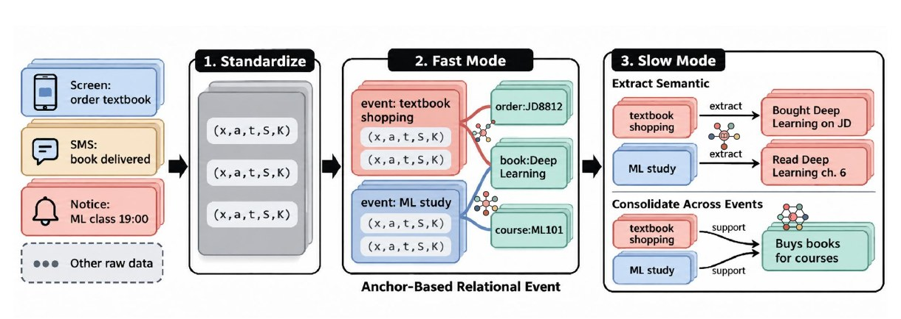
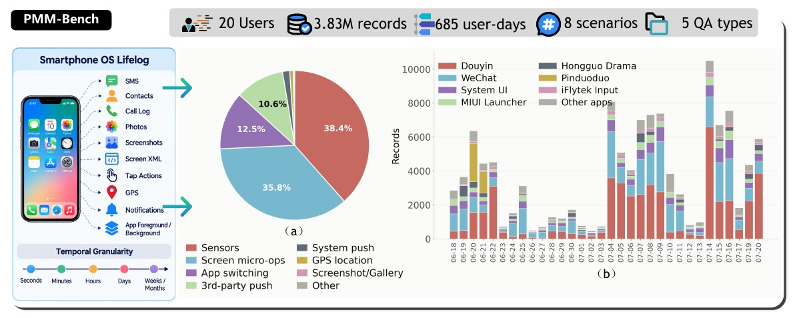

<div align="center">

# OS-Memory

**OS-Centric Personal Memory via Fast–Slow Hierarchical Event Graph**

[Repository](https://github.com/XiaoMi/os-memory) · [Library usage](../README.md) · [PMM-Bench](#pmm-bench) · [Results](#results)

</div>



A smartphone OS records the whole user trajectory: conversations, orders, locations and screens scattered across apps, modalities and time.
OS-Memory turns these traces into an evidence-grounded, event-centric hierarchical memory graph.

- **Standardize.** Device records become uniform atomic observations `(x, a, t, S, K)`.
- **Fast path, DRED.** Dual-Rate Evidence-Deferred attribution keeps parallel events online, matches by strong identifiers first, defers uncertain observations, and runs without a generative LLM.
- **Slow path, SAGE.** An LLM splits mixed events, writes summaries and anchors, extracts grounded facts, and consolidates long-term memory across events.
- **Grounded.** Every event, fact and long-term memory links back to its supporting observations.

The OS-Memory system itself is the `hypermem/` package at the repository root. The PMM-Bench evaluation toolkit and all baselines live in the separate [`eval/`](../eval/) tree.

## Use as a library

Embed OS-Memory in your own agent through `hypermem.HyperMemory`: `add` to save a batch of records (an in-memory list or generator), `build` to construct the event graph (DRED + SAGE), then `search` and `read` memories. Full guide in [`README.md`](../README.md).

```bash
pip install -e .                                       # from the repository root
```

Every record is `type` + `timestamp` + a `data` object holding everything else (record format in README.md, chapter 4):

```python
from hypermem import HyperMemory

mem = HyperMemory("./user_memory.db", config=config)   # LLM + embedding endpoints
mem.add([
    {"type": "sms", "timestamp": "2026-05-03T09:06:00+08:00",
     "data": {"from_app": "短信", "content": "【铁路12306】订单E2026050301已支付", "sender": "12306",
              "anchors": {"order_id": "E2026050301"}}},
])
mem.build()                                            # DRED + SAGE, once
print(mem.search("我最近的订单状态？")["context"])
mem.close()
```

The code map and stages are in [VERSION.md](VERSION.md); the ToolSAGE executor in [SAGE_TOOLS.md](SAGE_TOOLS.md).

## PMM-Bench



| Users | Records | User-days | Scenarios | Questions |
| --- | --- | --- | --- | --- |
| 20 | 3,829,719 | 685 | 8 | ~2,000, 5 types |

Question types: single-hop recall (Single), cross-application aggregation (Cross), temporal reasoning (Temp), event tracking (Track), habit induction (Habit).
Each question has a reference answer and an evidence set linking to supporting observations.

The raw records contain personal information. PMM-Bench is released in de-identified form under a research-only access agreement.

## Results

Response model GPT-4.1-mini, judge GPT-4o. Judge = unweighted mean of the five per-type scores.

| Method | Single | Cross | Temp | Track | Habit | Judge | F1 |
| --- | ---: | ---: | ---: | ---: | ---: | ---: | ---: |
| Long context (128K) | 22.8 | 4.2 | 7.6 | 5.9 | 10.0 | 10.1 | 8.7 |
| Flat dense retrieval | 43.6 | 14.8 | 19.2 | 16.5 | 19.7 | 22.8 | 19.9 |
| SimpleMem | 42.3 | 25.4 | 28.2 | 26.8 | 29.6 | 30.5 | 27.1 |
| LightMem | 38.7 | 22.6 | 25.9 | 24.3 | 27.2 | 27.7 | 24.4 |
| Mem0 | 40.2 | 18.9 | 22.4 | 19.6 | 24.8 | 25.2 | 22.3 |
| A-Mem | 41.5 | 26.9 | 29.4 | 28.6 | 30.8 | 31.4 | 27.9 |
| StructMem | 40.9 | 23.8 | 27.6 | 25.1 | 27.9 | 29.1 | 25.8 |
| CompassMem | 43.1 | 30.2 | 34.8 | 33.5 | 32.1 | 34.7 | 30.9 |
| CompassMem + identifier index | 43.4 | 35.6 | 35.4 | 35.9 | 32.8 | 36.6 | 32.6 |
| **OS-Memory** | **48.2** | **43.5** | **41.1** | **42.8** | **40.6** | **43.2** | **38.4** |

DRED also works as a plug-in: replacing the segmentation of LightMem, StructMem and CompassMem with DRED raises their Judge score by 3.2, 3.3 and 3.5 points.

## Evaluate on PMM-Bench

Evaluation runs from the [`eval/`](../eval/) tree. One command builds memory and answers questions for any set of systems and users.

```bash
cd eval
pip install -e .                                       # PMM-Bench toolkit
pip install -e ..                                      # OS-Memory core (repository root)

export OPENAI_BASE_URL=https://your-gateway/v1   OPENAI_API_KEY=...
export PMM_EMBEDDING_URL=https://your-embedder/v1/embeddings   PMM_EMBEDDING_MODEL=...

python -m pmm_bench users --data /path/to/PMM-Bench                 # list users
python -m pmm_bench run   --data /path/to/PMM-Bench --systems hyperos-mem --users U01 --out runs/one
python -m pmm_bench run   --data /path/to/PMM-Bench --systems hyperos-mem,mem0,simplemem --users all --jobs 4 --out runs/all
python -m pmm_bench report --out runs/all                           # results table
```

Each (system, user) pair writes resumable per-question records to `runs/<name>/results/<system>/<user>/`; rerunning the same command skips finished work. `report.md` gives per-type accuracy, Judge (unweighted mean of the five types) and F1.

OS-Memory runs through `pmm_bench.final`: DRED + full ToolSAGE. `pmm_bench.final` reads a protocol file (construction/answer/judge models and the LLM and embedding endpoints); `pmm_bench` writes one for you (`protocol.resolved.json`). Stages are `prepare`, `dred`, `sage`, `dashboard` and `evaluate`; `--stage all` runs them in order and every stage resumes from its journal. To check a finished build:

```bash
cd eval
python -m pmm_bench.final check --run runs/one/runs/hyperos-mem/U01/build
```

Baselines each run in their own Python environment (`PMM_PYTHON_MEM0=/path/to/env/bin/python`, …). Details: [eval/docs/EVALUATION.md](../eval/docs/EVALUATION.md). Baseline status: [eval/docs/BASELINES.md](../eval/docs/BASELINES.md).

Try the whole pipeline offline on the bundled synthetic sample (two invented users, no real data):

```bash
cd eval
python tests/mock_openai_server.py --port 8765 --dimension 64 &
export OPENAI_BASE_URL=http://127.0.0.1:8765/v1 OPENAI_API_KEY=offline \
       PMM_EMBEDDING_URL=http://127.0.0.1:8765/v1/embeddings PMM_EMBEDDING_MODEL=offline \
       NO_PROXY=127.0.0.1 no_proxy=127.0.0.1                # keep local requests off any proxy
echo '{"embedding": {"dimension": 64}}' > /tmp/offline.json
python -m pmm_bench run --data examples/pmm_sample --systems hyperos-mem,mock --users all \
       --out runs/offline --config /tmp/offline.json
```

The offline server returns placeholder text, so its scores are meaningless; it only proves the pipeline runs.

### Outputs of a build

| File | Contents |
| --- | --- |
| `memory.sqlite` | Observations, events, decisions, consolidation journal, SAGE layers |
| `dred_audit.json`, `sage_boundary_audit.json` | Structural audits after DRED and after SAGE boundary consolidation |
| `sage_report.json`, `sage_tool_jobs.json` | ToolSAGE completion gate and per-event tool journals |
| `frozen.json` | Hash of the memory evaluated |
| `final_run_contract.json` | Records that the run used the final method |
| `../hypermem_dashboard.html` | Offline browser view of the layered memory graph |

## Tests

From the repository root:

```bash
python -m unittest discover -s tests -t tests
```

The unit tests use local stand-ins for the encoder and the model; they check execution contracts, not accuracy.

## Repository layout

| Path | Contents |
| --- | --- |
| `hypermem/` | OS-Memory core; `api.py` is the library interface (`HyperMemory`) |
| `hypermem/online/` | DRED engine, SAGE slow path, graph retrieval |
| `tests/` | Unit tests of the core package |
| `README.md` | How to install, feed data, call the API and evaluate |
| `docs/` | This overview, the version statement (`VERSION.md`, `final_version.json`) and the ToolSAGE executor (`SAGE_TOOLS.md`) |
| `eval/` | PMM-Bench toolkit, baselines, configs, evaluation docs |
